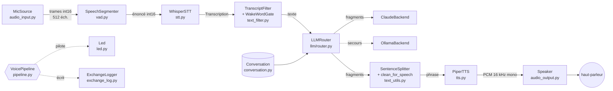
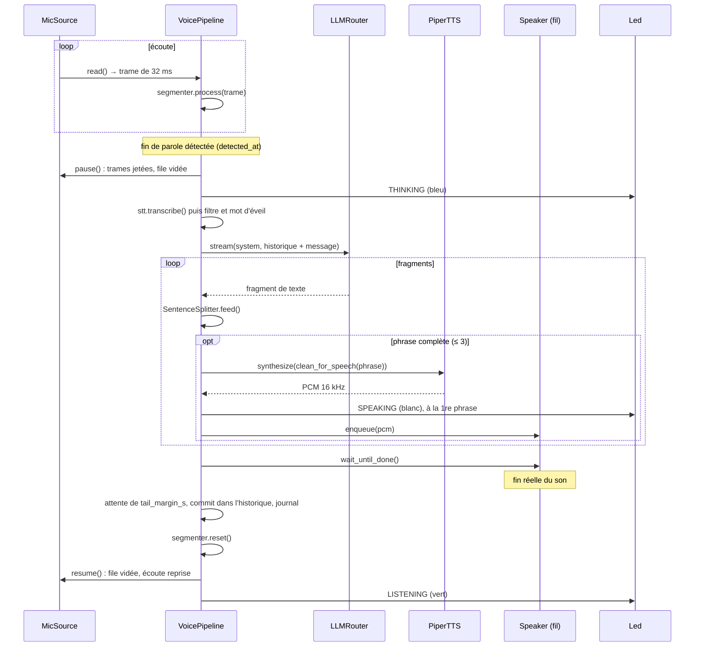
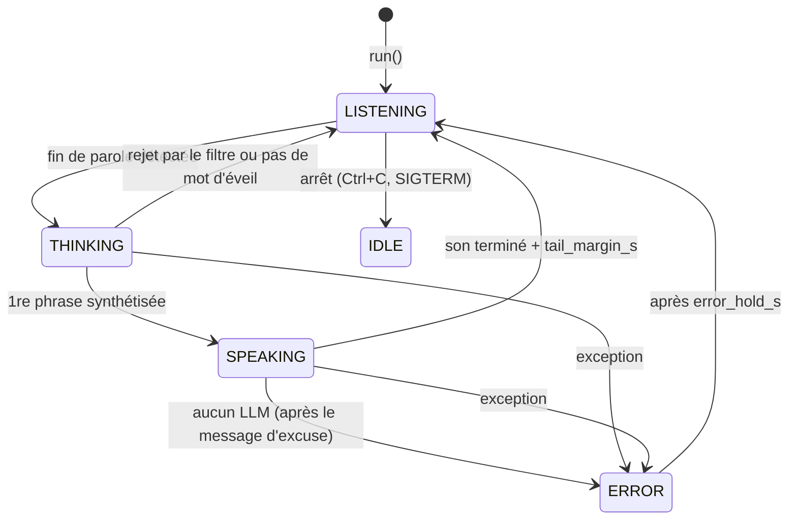

# J-ONE — documentation technique

Ce document décrit le fonctionnement interne du pipeline vocal, pour ceux qui doivent le modifier, le déboguer ou l'étendre. L'installation, le lancement et la correspondance avec le cahier des charges sont dans le [README principal](../README.md).

## Sommaire

1. [Vue d'ensemble](#1-vue-densemble)
2. [Modèle d'exécution](#2-modèle-dexécution)
3. [Déroulement d'un tour de parole](#3-déroulement-dun-tour-de-parole)
4. [Modules](#4-modules)
5. [Machine d'états et LED](#5-machine-détats-et-led)
6. [Gestion des erreurs](#6-gestion-des-erreurs)
7. [Mesure des latences](#7-mesure-des-latences)
8. [Format du journal des échanges](#8-format-du-journal-des-échanges)
9. [Configuration](#9-configuration)
10. [Tests](#10-tests)
11. [Étendre le pipeline](#11-étendre-le-pipeline)
12. [Hypothèses matérielles et limites connues](#12-hypothèses-matérielles-et-limites-connues)

---

## 1. Vue d'ensemble



Le code est organisé en un module par étape, avec des interfaces minimales entre elles. `VoicePipeline` ne connaît que ces interfaces : chaque brique est construite à part (dans `build_pipeline`, [jone/__main__.py](../jone/__main__.py)), puis injectée. C'est ce qui permet de remplacer le micro du G1 par celui du PC, ou de tester toute la boucle avec des doublures.

### Dépendances entre modules

```
__main__ ──► pipeline ──► conversation, led, text_utils, stt (type), llm.router
         ├─► audio_input, vad, stt, text_filter, tts, audio_output, exchange_log
         └─► config

audio_output, led ──► robot  (seul point d'entrée du SDK Unitree)
llm.router ──► llm.claude, llm.local ──► llm.base
llm.local ──► text_utils (ThinkStripper)
tts, audio_output ──► audio_utils
```

Les bibliothèques lourdes (`torch`, `faster_whisper`, `piper`, `anthropic`, `ollama`, `unitree_sdk2py`, `sounddevice`) ne sont importées que dans le constructeur de la classe qui les utilise. Le paquet reste donc importable, et les tests exécutables, sans elles.

## 2. Modèle d'exécution

Le processus a trois fils d'exécution :

| Fil | Créé par | Rôle |
|---|---|---|
| principal | `python -m jone` | boucle `VoicePipeline.run()` : VAD, STT, filtre, LLM, TTS, journal, LED |
| `g1-mic` (ou le callback de sounddevice) | `MicSource.start()` | reçoit l'audio et le redécoupe en trames dans une `queue.Queue` bornée |
| `speaker` | `Speaker.__init__()` | joue les phrases mises en file, dans l'ordre |

Ces fils ne partagent que deux files d'attente :

- **micro → principal** : `MicSource._queue`, au plus 500 trames (16 s). Si le fil principal prend du retard, la trame la plus ancienne est jetée.
- **principal → haut-parleur** : `Speaker._queue`, sans limite. Le compteur `_pending`, protégé par `_lock`, compte les phrases en file ou en cours de lecture. L'événement `_idle` n'est levé que quand ce compteur retombe à 0, ce qui évite de signaler « terminé » au moment exact où une nouvelle phrase arrive.

Le streaming du LLM, le découpage en phrases et la synthèse Piper se font dans le fil principal, à la suite. Pendant que Piper synthétise la phrase *n*, les fragments du LLM s'accumulent dans le tampon réseau, et le fil `speaker` joue la phrase *n − 1*. On obtient ainsi un recouvrement LLM / TTS / lecture sans fil supplémentaire.

## 3. Déroulement d'un tour de parole



Points importants :

- **L'écoute est coupée dès la fin de la phrase de l'utilisateur**, pas seulement pendant que le robot parle. Le robot ne peut donc pas être interrompu. C'est un choix de simplicité, qui garantit qu'aucune trame de sa propre voix n'est analysée.
- **La limite de 3 phrases est appliquée côté client** : dès la 3e phrase synthétisée, la boucle sort et le générateur du routeur est fermé (`stream.close()`), ce qui ferme aussi la connexion HTTP vers l'API.
- **Seuls les tours réussis entrent dans l'historique** (`statut == "ok"`), avec le texte réellement prononcé, et non le texte brut du LLM.

## 4. Modules

### 4.1 `config.py` — configuration

`DEFAULTS` contient toutes les clés avec leur valeur par défaut. `load_config(path)` charge `.env` (via python-dotenv), lit le YAML et le fusionne récursivement sur `DEFAULTS` (`_deep_merge`). Toute clé absente du YAML garde donc sa valeur par défaut. `resolve_path()` rend les chemins relatifs à la racine du projet, quel que soit le répertoire de lancement.

La configuration circule sous forme de `dict` imbriqué. Chaque classe a un `from_config(cfg)` qui en extrait sa section.

### 4.2 `audio_input.py` — capture

```python
class MicSource:
    start(); close()
    read(timeout) -> np.ndarray[int16, 512] | None
    pause(); resume(); flush()
    _push(samples)        # appelé par le producteur
```

`_push` concatène les échantillons reçus au reste de l'appel précédent (`_pending`) et en sort des trames de taille fixe (`frame_samples`). Pendant `pause()`, tout ce qui arrive est jeté sans être mis en file.

| Implémentation | Source | Notes |
|---|---|---|
| `SoundDeviceMic` | `sd.InputStream`, 16 kHz, mono, int16, `blocksize=512` | callback dans le fil audio de PortAudio |
| `G1MulticastMic` | socket UDP, `IP_ADD_MEMBERSHIP` sur `g1_multicast_group` via `g1_local_ip` | fil `g1-mic`, `recvfrom` avec un délai de 1 s pour pouvoir s'arrêter proprement ; octet impair final ignoré |

### 4.3 `vad.py` — détection de parole

`SileroVAD` est un appelable `frame -> probabilité`. Il convertit la trame int16 en float32 dans [-1, 1], puis appelle le modèle torch de `silero_vad` avec `torch.set_num_threads(1)` pour ne pas concurrencer Whisper. `reset()` réinitialise l'état récurrent du modèle.

`SpeechSegmenter` est une machine à deux états :

```
              prob ≥ threshold
   ATTENTE ─────────────────────────► PAROLE
     ▲  (pré-enregistrement :                 │ prob < neg_threshold → silence_run += 1
     │   pre_roll_ms dans une deque)           │ prob ≥ neg_threshold → silence_run = 0
     │                                        │ prob ≥ threshold     → speech_frames += 1
     │  silence_run ≥ min_silence_frames      │
     └────── ou durée ≥ max_utterance_s ◄─────┘
             → énoncé émis si speech_frames ≥ min_speech_frames
```

- L'énoncé émis = pré-enregistrement + trames de parole. Le silence final est retiré, sauf si la fin a été forcée par `max_utterance_s`.
- Avec des trames de 32 ms, les durées sont converties en nombre de trames par arrondi (`min_speech_ms: 250` → 8 trames, `min_silence_ms: 600` → 19 trames).

### 4.4 `stt.py` — transcription

`WhisperSTT.transcribe(audio) -> Transcription(text, avg_logprob, no_speech_prob, compression_ratio, audio_s, elapsed_ms)`.

Paramètres faster-whisper fixés : `language="fr"`, `vad_filter=False` (Silero est déjà passé), `condition_on_previous_text=False` (évite qu'une hallucination se propage d'un énoncé à l'autre) et `without_timestamps=True`. Les métriques de confiance sont agrégées sur les segments : moyenne de `avg_logprob`, maximum de `no_speech_prob` et de `compression_ratio`.

Si `WhisperModel(device="cuda")` lève `ValueError` ou `RuntimeError` (CTranslate2 compilé sans CUDA), le constructeur retente sur le CPU en `int8` et écrit un avertissement dans le journal.

### 4.5 `text_filter.py` — filtre et mot d'éveil

`TranscriptFilter.check(t) -> FilterResult(accepted, text, reason)`. Les règles sont appliquées dans cet ordre ; la première qui s'applique donne le motif :

| Ordre | Règle | Motif |
|---|---|---|
| 1 | moins de `min_chars` caractères alphanumériques après normalisation | `vide` |
| 2 | texte normalisé dans `DEFAULT_BLACKLIST` + `filter.blacklist` | `hallucination connue` |
| 3 | texte dans `SUSPICIOUS_SHORT` (« merci », « au revoir »…) et `no_speech_prob > 0,3` ou `avg_logprob < -0,6` | `hallucination probable` |
| 4 | `no_speech_prob > max_no_speech_prob` **et** `avg_logprob < min_avg_logprob` | `probablement pas de parole` |
| 5 | `compression_ratio > max_compression_ratio` | `texte répétitif` |
| 6 | un même trigramme répété au moins 4 fois | `boucle de répétition` |

La normalisation (`normalize`) passe en NFC et en minuscules, uniformise les apostrophes, retire `[]()*♪♫` et la ponctuation en bordure.

`WakeWordGate.admit(text, now) -> str | None` :
- désactivé : renvoie le texte tel quel ;
- mot d'éveil trouvé : le retire, avec la ponctuation qui le suit, et renvoie le reste (`"Bonjour"` si le reste est vide) ;
- pas de mot d'éveil, mais dernier échange il y a moins de `session_timeout_s` : renvoie le texte ;
- sinon : `None`, et l'énoncé est journalisé avec le statut `ignore`.

### 4.6 `llm/` — modèles de langage

L'interface commune est le protocole `LLMBackend` ([llm/base.py](../jone/llm/base.py)) :

```python
class LLMBackend(Protocol):
    name: str
    def stream(self, system: str, messages: list[dict]) -> Iterator[str]: ...
    def warmup(self) -> None: ...
```

Toute erreur d'un backend est convertie en `LLMError`, ou en `LLMRefusal` pour un refus du modèle. Le routeur ne connaît que ces deux exceptions.

**`ClaudeBackend`** ([llm/claude.py](../jone/llm/claude.py))

- `anthropic.Anthropic(timeout=Timeout(first_token_timeout_s, connect=connect_timeout_s), max_retries=0)`.
- Requête : `messages.stream(model="claude-haiku-5-5", max_tokens=300, system=..., messages=..., output_config={"effort": "low"}, thinking={"type": "disabled"})`.
- Le délai de *lecture* httpx s'applique à chaque lecture du socket. Il couvre donc l'attente du premier jeton, mais aussi un blocage en cours de flux. C'est lui qui joue le rôle de seuil de bascule de l'ENF-04.
- `max_retries=0` : en conversation, une nouvelle tentative coûterait plus cher qu'une bascule immédiate.
- Correspondance des exceptions : `APITimeoutError` → « délai dépassé », `APIConnectionError` → « connexion impossible », `AuthenticationError`, `RateLimitError`, `APIStatusError`. Le `stop_reason == "refusal"` du message final lève `LLMRefusal`.
- La réflexion est désactivée : pour des réponses d'une à trois phrases, elle n'apporte rien et retarde la première phrase. Haiku 5.5 accepte `disabled` jusqu'à l'effort `high` ; au-delà, il faudrait retirer `disable_thinking`.

**`OllamaBackend`** ([llm/local.py](../jone/llm/local.py))

- `ollama.Client(host, timeout=timeout_s).chat(model="qwen3:4b", stream=True, think=False, options={"num_predict", "temperature"}, keep_alive="30m")`.
- Le prompt système est envoyé comme premier message `role: system`.
- Un `ThinkStripper` filtre en flux d'éventuelles balises `<think>…</think>`, même coupées entre deux fragments.
- `warmup()` appelle `generate(prompt="")` au démarrage pour charger le modèle en mémoire, ce qui évite environ 10 s au premier appel.
- Toute exception (connexion, `ResponseError`, httpx) devient une `LLMError`.

**`LLMRouter`** ([llm/router.py](../jone/llm/router.py))

```python
stream(system, messages, info: RouteInfo) -> Iterator[str]
RouteInfo(backend, fallback, errors, first_token_s)    # rempli pendant le flux
```

Algorithme :

```
candidats = [cloud si disponible et hors pénalité] + [local]
pour chaque candidat :
    essayer de streamer
      1er fragment  → info.backend, info.fallback, info.first_token_s
      LLMRefusal    → REFUSAL_REPLY si rien n'a été dit, puis fin
      LLMError      → si cloud : pénalité de retry_cooldown_s
                      si déjà dit quelque chose : fin (réponse partielle gardée)
                      sinon : candidat suivant
si tous ont échoué → NoBackendAvailable
```

`clock` est injectable (horloge simulée dans les tests de la pénalité). Si `ANTHROPIC_API_KEY` et `ANTHROPIC_AUTH_TOKEN` sont absentes, `create_router` ne crée pas le backend cloud et le robot fonctionne en local seulement.

### 4.7 `conversation.py` — historique

Liste de messages `{"role", "content"}`. `with_user(text)` construit la requête du tour sans modifier l'historique. `commit(user, assistant)` ajoute les deux messages, puis supprime les plus anciens au-delà de `2 × history_max_turns`. Le même historique sert aux deux LLM, ce qui garde le contexte lors d'une bascule.

### 4.8 `text_utils.py` — texte pour l'oral

- **`SentenceSplitter.feed(delta) -> list[str]`** : coupe sur `[.!?…]+` suivi d'un espace, sauf après `M`, `Dr`, `Mme` et `etc` (lookbehinds). Un nombre décimal comme `1.32` n'est pas coupé, faute d'espace après le point. Si le tampon dépasse `soft_limit` (140 caractères) sans fin de phrase, il est coupé à la dernière virgule, pour ne pas retarder la première sortie audio. `flush()` rend le reste.
- **`clean_for_speech(text)`** : liens markdown réduits à leur texte, URL et puces supprimées, balises markdown retirées, symboles convertis en mots (`%` → « pour cent », `°C` → « degrés »…) *avant* le retrait des caractères Unicode de catégorie `So` (emoji, pictogrammes). L'espace français avant `!?:;` est conservé.
- **`ThinkStripper`** : voir 4.6.

### 4.9 `tts.py` — synthèse

`PiperTTS.synthesize(text) -> bytes` (PCM 16 kHz mono int16 LE). Compatible avec l'API de piper-tts ≥ 1.3 (`voice.synthesize(text, syn_config)` → `AudioChunk.audio_int16_bytes`) et avec l'ancienne (`synthesize_stream_raw`), détectée par `hasattr`. La voix siwis « medium » sort en 22 050 Hz et est rééchantillonnée.

### 4.10 `audio_utils.py` — format audio

`to_pcm16k_mono(samples, rate, channels)` : passage en float32, conversion en mono (moyenne des canaux), rééchantillonnage polyphasé (`scipy.signal.resample_poly`, rapport réduit par PGCD, 160/441 pour 22 050 → 16 000), écrêtage, puis int16 little-endian.

### 4.11 `audio_output.py` — restitution

```python
class Speaker:
    begin_response()          # remet à zéro first_audio_at, nouvel id de flux (G1)
    enqueue(pcm)
    wait_until_done(timeout) -> bool
    first_audio_at            # perf_counter du 1er son de la réponse
    stop(); close()
    # à implémenter : _play_blocking(pcm), _drain(), _stop_playback()
```

**`G1Speaker`** : `PlayStream()` met l'audio en tampon côté robot et rend la main tout de suite. Pour savoir quand le son se termine vraiment, la classe tient une horloge de fin de lecture, `_play_end` :

```
pour chaque bloc de chunk_seconds (1 s = 32 000 octets) :
    si _play_end < maintenant : _play_end = maintenant    (haut-parleur muet → nouveau départ)
    PlayStream(app_name, stream_id, bloc)
    _play_end += durée(bloc)
    dormir jusqu'à _play_end − lead_seconds               (jamais plus de 0,5 s d'avance)
_drain() : dormir jusqu'à _play_end                       (quand la file est vide)
```

Toutes les phrases d'une réponse partagent un `stream_id` (horodatage en millisecondes, créé dans `begin_response`) et s'enchaînent dans le même flux.

`SoundDeviceSpeaker` appelle `sd.play(..., blocking=True)`. `NullSpeaker` dort pendant la durée du PCM.

### 4.12 `robot.py` — SDK Unitree

`get_audio_client(robot_cfg)` est un singleton protégé par verrou : `ChannelFactoryInitialize(0, network_interface)` une seule fois par processus, puis `AudioClient()`, `SetTimeout()` et `Init()`. `G1Speaker` et `G1Led` partagent cette instance. **Aucun client de locomotion n'est importé dans le projet.**

### 4.13 `exchange_log.py` et `metrics.py`

`ExchangeLogger.write(record)` ajoute l'horodatage ISO 8601 local et écrit une ligne JSON dans `logs/echanges-AAAAMMJJ.jsonl`, sous verrou. `setup_logging()` configure la console et un fichier `logs/jone.log` tournant (5 × 5 Mo), et réduit `httpx`, `httpcore` et `anthropic` au niveau WARNING.

`metrics.py` : WER par distance d'édition sur les mots après normalisation (minuscules, ponctuation retirée, apostrophes et traits d'union transformés en espaces), WER de corpus pondéré par le nombre de mots, et percentiles par interpolation linéaire.

## 5. Machine d'états et LED



`Led.set_state()` n'envoie de commande que si l'état change, et attrape toute exception du matériel : une LED défaillante n'arrête jamais le pipeline. Les couleurs sont dans `led.colors`.

## 6. Gestion des erreurs

| Situation | Comportement | Statut journalisé |
|---|---|---|
| transcription rejetée | retour à l'écoute, pas d'appel au LLM | `rejete` + `motif` |
| pas de mot d'éveil | retour à l'écoute | `ignore` |
| cloud en échec avant le 1er fragment | bascule vers le local, pénalité sur le cloud | `ok`, `bascule: true`, `erreurs_llm` |
| cloud en échec en cours de réponse | réponse partielle prononcée, pas de bascule | `ok`, `erreurs_llm` |
| refus du modèle | phrase de refus poli | `ok` |
| aucun LLM disponible | message d'excuse, LED rouge, historique inchangé | `erreur_llm` |
| LLM ne produit rien de prononçable | « Pardon, je n'ai pas compris… » | `reponse_vide` |
| toute autre exception dans un tour | `speaker.stop()`, LED rouge, trace dans `jone.log`, écoute reprise | pas de ligne dans le journal des échanges |
| erreur dans le fil `speaker` | journalisée, la phrase suivante est jouée | — |
| erreur LED | journalisée, ignorée | — |

`SIGTERM` et `Ctrl+C` arrêtent proprement : fermeture du haut-parleur, LED éteinte, socket du micro fermé.

## 7. Mesure des latences

Tous les instants sont pris avec `time.perf_counter()`.

| Champ (`latences_ms`) | De → à |
|---|---|
| `stt` | durée de `transcribe()` |
| `llm_premier_jeton` | appel du routeur → 1er fragment (bascule comprise) |
| `tts_premiere_phrase` | durée de synthèse de la 1re phrase |
| `bout_en_bout` | **fin de parole estimée** → `Speaker.first_audio_at` |
| `total` | fin de parole estimée → fin du tour (son terminé + `tail_margin_s`) |

La fin de parole estimée vaut `detected_at − min_silence_ms`. Le VAD ne déclare la fin qu'après ce silence, qui fait partie de la latence perçue par l'utilisateur. `bout_en_bout` correspond ainsi à la définition de l'ENF-01 (« fin de parole → début de la réponse audio »). Pour le G1, `first_audio_at` est l'instant où le premier bloc a été remis à `PlayStream()` : la latence interne du haut-parleur n'est pas comptée, elle est à mesurer une fois par vidéo.

Budget indicatif pour tenir 2,5 s avec Claude :

| Étape | Ordre de grandeur visé |
|---|---|
| silence de fin (VAD) | 600 ms (réglable) |
| Whisper turbo sur GPU, énoncé de 3 s | 300 à 600 ms |
| Claude, premier jeton (Wi-Fi) | 400 à 900 ms |
| attente de la 1re phrase complète | 100 à 400 ms |
| Piper, 1re phrase | 100 à 300 ms |

## 8. Format du journal des échanges

Une ligne JSON par énoncé, dans `logs/echanges-AAAAMMJJ.jsonl` :

```json
{
  "horodatage": "2026-10-26T14:03:12.418+01:00",
  "transcription": "Bonjour, qui es-tu ?",
  "audio_s": 1.92,
  "stt": {"avg_logprob": -0.183, "no_speech_prob": 0.012, "compression_ratio": 0.89},
  "latences_ms": {
    "stt": 412.3,
    "llm_premier_jeton": 611.8,
    "tts_premiere_phrase": 142.6,
    "bout_en_bout": 1874.2,
    "total": 6420.9
  },
  "statut": "ok",
  "reponse": "Bonjour ! Je suis J-ONE, un robot humanoïde ravi de discuter avec vous.",
  "llm": "claude",
  "bascule": false,
  "erreurs_llm": []
}
```

- `statut` : `ok`, `rejete`, `ignore`, `erreur_llm` ou `reponse_vide`. Les lignes `rejete` et `ignore` n'ont ni `reponse` ni `llm`, mais ont un `motif`.
- `llm` : `claude`, `qwen3-local` ou `null`.
- En mode texte (`--text`), il n'y a pas de champs `stt` ni `audio_s`, et `bout_en_bout` part de la validation de la saisie.

`tools/rapport_tests.py` exploite ce format. Toute modification des noms de champs doit y être reportée.

## 9. Configuration

Référence complète : [config.yaml](../config.yaml), commenté. Les valeurs par défaut sont dans `DEFAULTS` ([jone/config.py](../jone/config.py)). Le fichier [config.pc.yaml](../config.pc.yaml) ne contient que les différences pour un PC, fusionnées sur les valeurs par défaut (et non sur `config.yaml`).

Surcharges en ligne de commande : `--no-cloud`, `--no-local`, `--input`, `--output`, `--led`.

Variables d'environnement :

| Variable | Usage |
|---|---|
| `ANTHROPIC_API_KEY` | clé de l'API (fichier `.env`, jamais versionné) |
| `ANTHROPIC_AUTH_TOKEN` | alternative à la clé |
| `ANTHROPIC_BASE_URL` | autre point d'accès ; `bench_llm.py --simulate-outage` s'en sert pour simuler une panne |
| `CYCLONEDDS_HOME` | requis par `unitree_sdk2_python` |

## 10. Tests

```bash
pip install -r requirements-dev.txt
python -m pytest
```

Les tests n'ont besoin d'aucun matériel ni modèle : `numpy`, `scipy`, `pyyaml` et `python-dotenv` suffisent. `tests/conftest.py` ajoute la racine et `tools/` au `sys.path`.

| Fichier | Ce qui est couvert | Doublures |
|---|---|---|
| `test_vad.py` | déclenchement, pré-enregistrement, bruit court ignoré, hystérésis, durée max, reset | `ScriptedVAD` : la probabilité est lue dans l'amplitude de la trame |
| `test_text_filter.py` | chaque règle du filtre, mot d'éveil et session | — |
| `test_text_utils.py` | découpage en flux, abréviations, coupure longue, nettoyage, `ThinkStripper` | — |
| `test_router.py` | bascule, pénalité et nouvelle tentative, réponse partielle, refus, aucun backend | `FakeBackend`, `Clock` |
| `test_pipeline.py` | tour complet, 3 phrases max, bascule, erreur LLM, réponse vide, filtre, mot d'éveil, rapport | `FakeBackend`, `FakeTTS`, `RecordingLed`, `MemoryLog`, `FakeMic`, `FakeSTT`, `NullSpeaker` |
| `test_misc.py` | conversion audio, historique, WER, percentiles, chargement des configs | — |

Les tests avec le matériel sont décrits dans [plan_de_tests.md](plan_de_tests.md).

## 11. Étendre le pipeline

**Ajouter un LLM** (un autre modèle local, par exemple) : créer une classe avec `name`, `stream(system, messages)` qui produit des `str` et lève `LLMError`, et `warmup()`. L'instancier dans `create_router`. Pour plus de deux niveaux de secours, remplacer `cloud` et `local` par une liste ordonnée dans `LLMRouter._candidates()`.

**Ajouter une source audio** : hériter de `MicSource`, implémenter `start()` et `close()`, et appeler `self._push(int16_array)` à chaque réception, sans se soucier de la taille des blocs. L'ajouter dans `create_mic` et dans les choix de `--input`.

**Ajouter une sortie audio** : hériter de `Speaker` et implémenter `_play_blocking(pcm)`. Si la sortie bufferise (comme le G1), implémenter aussi `_drain()` pour attendre la fin réelle du son, sinon l'écoute reprendrait trop tôt. Appeler `_mark_first_audio()` au premier son.

**Changer de voix** : déposer `xxx.onnx` et `xxx.onnx.json` dans `voices/`, puis changer `tts.voice_model`. Le rééchantillonnage s'adapte à la fréquence de la voix.

**Une autre langue** (hors périmètre aujourd'hui) : `stt.language`, une voix Piper, un prompt système, et les listes `DEFAULT_BLACKLIST` / `SUSPICIOUS_SHORT` du filtre, qui sont propres au français.

**Interrompre le robot pendant qu'il parle** (« barge-in », non demandé) : ne pas mettre le micro en pause pendant `SPEAKING`, faire tourner le VAD en parallèle avec un seuil plus haut, et appeler `speaker.stop()` au déclenchement. Cela suppose une annulation d'écho matérielle fiable, à vérifier d'abord.

## 12. Hypothèses matérielles et limites connues

Ces hypothèses n'ont pas encore été vérifiées sur le robot. `tools/test_g1_audio.py` permet de les confirmer :

| Hypothèse | Où dans le code | Si elle est fausse |
|---|---|---|
| micro diffusé en UDP multicast `239.168.123.161:5555`, PCM 16 kHz mono int16 LE | `G1MulticastMic`, `config.yaml` | corriger le groupe et le port ; si le flux est stéréo ou multicanal, convertir en mono dans `_run` avec `to_mono` |
| `PlayStream(app_name, stream_id, bytes)` accepte des octets PCM bruts, mis en tampon côté robot | `G1Speaker._play_blocking` | adapter le type passé (ex. `list(chunk)`) ou la taille des blocs |
| code de retour 0 = succès pour `PlayStream` et `LedControl` | `G1Speaker`, `G1Led` | ajuster la condition d'avertissement |
| réseau interne sur `eth0` | `robot.network_interface` | mettre le nom donné par `ip a` |
| CTranslate2 avec CUDA disponible | `WhisperSTT` | repli automatique sur le CPU, latence non tenue : jetson-containers ou compilation de CTranslate2 |

Limites connues :

- **Pas d'interruption possible** pendant que le robot parle (voir 11).
- **Pas de réduction de bruit logicielle** : le projet compte sur celle du réseau de micros, plus le VAD et le filtre.
- **Le seuil de bascule ne couvre pas toute la réponse** : un flux qui envoie un fragment toutes les 2,9 s ne sera jamais coupé avec un seuil à 3 s. Pour plafonner aussi la durée totale, ajouter une échéance dans `ClaudeBackend.stream`.
- **La mémoire GPU n'est pas surveillée** pendant le fonctionnement (seulement dans `bench_stt.py`).
- **Le niveau de batterie n'est pas lu** : la vérification avant chaque session est manuelle.
- **L'historique ne survit pas** à un redémarrage du processus.
