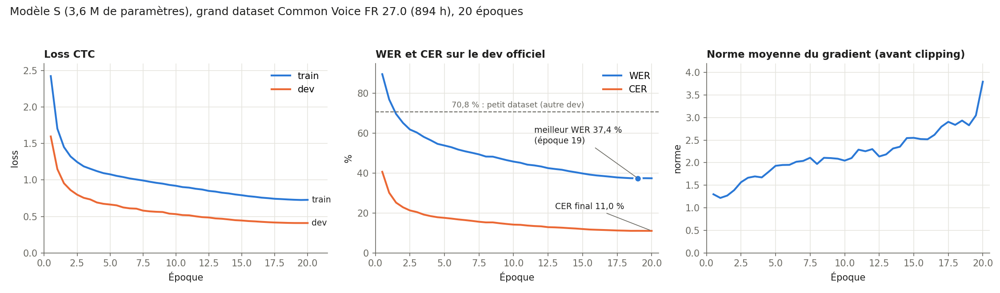
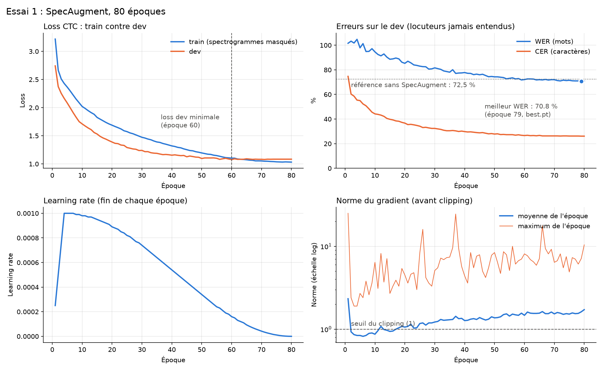
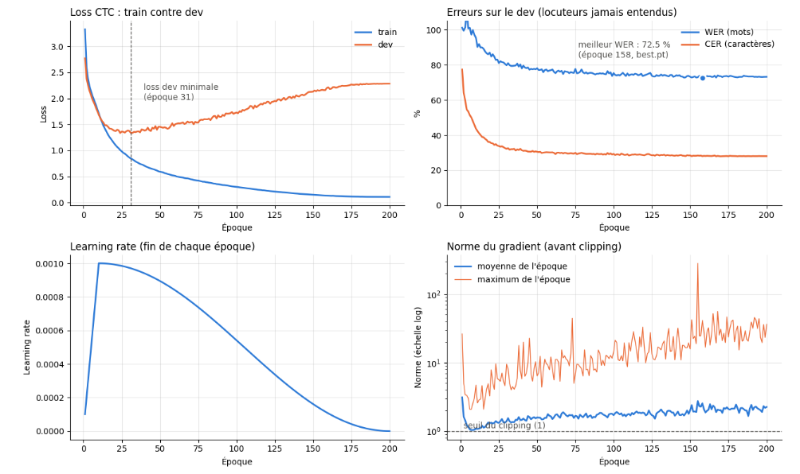

# J-ONE — État d'avancement : reconnaissance vocale avec notre propre Transformer

*Dernière mise à jour : 27 novembre 2026 · Branche `stt-transformer-junior` · Dossier [`recherche/stt_transformer/`](../recherche/stt_transformer/)*

Ce document fait le point, en deux pages, sur la partie **reconnaissance vocale (STT) développée de zéro**. Le détail de chaque étape et de chaque décision est dans le [journal du projet](../recherche/stt_transformer/JOURNAL_PROJET.md). La théorie et le code commenté sont dans les [notions théoriques](../recherche/stt_transformer/NOTIONS_THEORIQUES.md).

## 1. En bref

- **Objectif :** concevoir et entraîner **notre propre modèle Transformer** de reconnaissance vocale en français, sans modèle pré-entraîné, pour comprendre et maîtriser toute la chaîne (données, modèle, entraînement, évaluation). Ensuite viendront l'anglais, puis la synthèse vocale (TTS).
- **Situation :**
  - le pipeline complet fonctionne de bout en bout ;
  - un premier modèle a été entraîné sur GPU (Kaggle) : **WER de 72,5 %** et **CER de 28,0 %** sur des locuteurs jamais entendus. Il **mémorisait** les données d'entraînement (overfitting) ;
  - avec **SpecAugment** (une augmentation de données), l'overfitting a disparu : **WER de 70,8 %**, **CER de 26,1 %**, en 80 époques au lieu de 200 ;
  - le modèle **entend** correctement la plupart des sons, mais **orthographie** encore mal les mots. Il manque maintenant surtout de **données**.
- **Fait :** l'analyse (EDA) du **grand dataset** (*Scripted Speech 27.0* FR) : **894 h** de train et **10 295 voix**, soit 47 fois plus d'heures que le petit dataset. Les données sont propres, et nos choix précédents restent valables.
- **Fait :** l'entraînement du même modèle (taille S, avec SpecAugment) sur le **grand dataset** : 20 époques, environ 21 h de GPU en 3 sessions (Colab puis Kaggle). **WER de 37,4 %** et **CER de 11,0 %** sur le dev officiel (16 207 clips), sans overfitting. Le dev n'est pas le même que pour les essais précédents : une comparaison sur les mêmes clips reste à faire.
- **Fait :** l'évaluation unique sur le **test officiel** (15 936 clips, voix jamais entendues, jamais utilisées pour choisir) : **WER de 43,3 %** et **CER de 14,4 %**. **C'est le chiffre à annoncer pour le modèle actuel.** Il est 6 points plus haut que sur le dev.
- **Fait :** la **vraie comparaison**, sur les mêmes 484 clips de l'ancien dev : **70,8 % → 38,3 %** de WER, presque deux fois moins d'erreurs, avec le même modèle. Seules les données ont changé.
- **Fait :** la **vitesse sur CPU** (portable Intel i5 de 2017) : **RTF de 0,014**, soit environ 70 fois plus rapide que le temps réel, et 75 ms d'attente par phrase. La vitesse n'est pas un problème pour le robot : la limite est la précision.
- **Place dans le robot :** ce modèle est un **travail de recherche**. Le pipeline du robot continue d'utiliser **Whisper** ([`jone/stt.py`](../jone/stt.py)) tant que notre modèle n'atteint pas une qualité comparable. La comparaison sera faite avec les mêmes métriques (WER, RTF).

## 2. Ce qui est fait

| Étape | Statut | Résultat principal |
|---|---|---|
| Choix et récupération des données | ✅ | Common Voice FR, *Scripted Speech 26.0* (fr-FR + fr-CA), plus un corpus de parole spontanée pour les tests. Téléchargement via l'API Mozilla Data Collective |
| Analyse exploratoire (EDA) | ✅ | Train : 12 982 clips (environ 19 h, 275 locuteurs). Dev : 484 clips. Test : 285 clips. Choix du vocabulaire (49 caractères + le blank du CTC) |
| Prétraitement audio et texte | ✅ | 16 kHz mono, log-Mel à 80 bandes (fenêtres de 25 ms décalées de 10 ms, mêmes réglages que Whisper), normalisation du texte |
| Modèle | ✅ | Transformer encodeur écrit à la main : sous-échantillonnage ÷ 4 par convolutions, 12 blocs, attention multi-tête, loss CTC. **3,6 M de paramètres.** Chaque bloc a été vérifié contre l'implémentation de référence de PyTorch |
| Test d'overfitting (10 clips) | ✅ | Le modèle apprend 10 phrases par cœur (WER de 3,7 %) : le code d'entraînement est correct |
| Entraînement GPU sur Kaggle | ✅ | 200 époques en 4 h 43, avec sauvegardes et reprise après coupure |
| Métriques | ✅ | WER, CER, losses train et dev, learning rate et norme du gradient, suivis à chaque époque |
| SpecAugment (essai 1) | ✅ | 80 époques en 1 h 52. WER de 72,5 % → **70,8 %**, overfitting supprimé |
| EDA du grand dataset | ✅ | Train : 621 982 clips (893,8 h, 10 295 locuteurs). Dev et test : 16 207 clips chacun (environ 26 h), sans locuteur commun avec le train. Vocabulaire de 49 caractères conservé (1,55 % des phrases écartées). 113 clips à retirer (contrainte du CTC) |
| Entraînement sur le grand dataset | ✅ | 20 époques (382 640 steps), sauvegardes tous les 2 000 steps et reprise au milieu d'une époque. **WER dev 37,4 %, CER dev 11,0 %** |
| Évaluation sur le test officiel | ✅ | Mesurée une seule fois, sur 15 936 clips : **WER 43,3 %, CER 14,4 %**. WER de 56,5 % sur les clips de moins de 3 s |
| Comparaison sur l'ancien dev et RTF | ✅ | Mêmes 484 clips : **70,8 % → 38,3 %** de WER. Ancien test : 44,7 %. **RTF CPU 0,014**, latence médiane 75 ms |

## 3. Résultats

### Grand dataset : 894 h, 20 époques (meilleur modèle actuel)

| Mesure | Valeur | Lecture |
|---|---|---|
| **WER dev officiel** | **37,4 %** (meilleur : 37,38 %, époque 19) | Dev différent du petit dataset. **Sur les mêmes clips (ancien dev) : 38,3 % contre 70,8 %**, presque deux fois moins d'erreurs |
| **CER dev officiel** | **11,0 %** | Le son est bien perçu. Les erreurs restantes sont surtout de l'orthographe |
| Loss train / dev en fin d'entraînement | 0,73 / 0,41 | Pas d'overfitting : SpecAugment et dropout rendent le train plus difficile que le dev |
| Durée | 20 époques, environ 21 h de GPU (0,21 s par step sur Kaggle) | 3 sessions, avec reprise depuis `last.pt` |
| **WER test officiel** | **43,3 %** (15 936 clips) | **Le chiffre à annoncer.** 6 points au-dessus du dev : le modèle trouve ces voix plus difficiles (loss 0,55 contre 0,41) |
| **CER test officiel** | **14,4 %** | Seulement 3,9 % des phrases sont sans aucune erreur de mot |
| WER test par durée | < 3 s : 56,5 % · 3-5 s : 43,9 % · 5-7 s : 41,7 % · ≥ 7 s : 44,8 % | Les phrases courtes sont les plus mal reconnues. Or les commandes au robot sont souvent courtes |
| **RTF sur CPU** (batch de 1) | **0,014** · latence médiane 75 ms (phrases de 6 s) | Environ 70 fois plus rapide que le temps réel, sur un portable de 2017. Beaucoup de marge pour un modèle plus gros |

**Lecture :**
- Avec le **même modèle**, seules les **données** ont changé : le diagnostic de sous-apprentissage était le bon.
- Le WER plafonne pendant les 2 dernières époques, quand le learning rate approche de 0.
- La norme du gradient a augmenté pendant tout l'entraînement (de 1,2 à 3,8 en moyenne). Le clipping l'a contenue sans effet sur la loss, mais c'est à surveiller pour un modèle plus gros.

### Essai 1 : SpecAugment (petit dataset)

| Mesure | Référence (200 ép.) | SpecAugment (80 ép.) |
|---|---|---|
| **WER dev** | 72,5 % | **70,8 %** |
| **CER dev** | 28,0 % | **26,1 %** |
| Loss train / dev en fin d'entraînement | 0,11 / 2,29 (overfitting) | 1,03 / 1,08 (plus d'overfitting) |
| Durée | 4 h 43 | 1 h 52 |

**Lecture :**
- Le gain de WER est modeste. Avec un seul entraînement, sur un dev de 484 clips, la variation d'un lancement à l'autre est d'environ ±1 point.
- Le vrai changement est dans le diagnostic : le modèle ne mémorise plus, mais il **plafonne**. On est passé du sur-apprentissage au **sous-apprentissage** : il lui faut maintenant **plus de données**.

### Modèle de référence (sans augmentation)

| Mesure | Valeur | Lecture |
|---|---|---|
| **WER dev** (mots faux) | **72,5 %** (époque 158) | La métrique qui compte pour le robot |
| **CER dev** (lettres fausses) | **28,0 %** | Environ 3 lettres sur 4 sont justes : le son est bien perçu |
| Loss train / dev en fin d'entraînement | 0,11 / 2,29 | **Overfitting** : la loss dev remonte dès l'époque 31 |
| Durée | 1,4 min par époque sur GPU T4 | 40 fois plus rapide que sur le PC |

**Diagnostic :**
1. **Le facteur limitant est la quantité de données.** 19 h, c'est peu : Whisper a été entraîné sur 680 000 h.
2. **Le modèle n'a aucune notion de mot français valide.** Une seule lettre fausse rend le mot entier faux, d'où l'écart entre le WER et le CER.
3. **Presque tout le gain arrive avant l'époque 50.** Les essais suivants seront plus courts.

## 4. Décisions clés

Chaque décision est justifiée dans le journal. Un tableau de synthèse s'y trouve sous le titre « Sur quoi reposent les hyperparamètres de la référence ».

| Sujet | Choix | Raison principale |
|---|---|---|
| Approche | Notre propre Transformer, appris de zéro | Objectif pédagogique et de recherche du projet |
| Loss | CTC, sur des caractères | Simple, adaptée à un encodeur seul, pas besoin d'aligner l'audio et le texte à la main |
| Taille du modèle | « S », 3,6 M de paramètres | Proportionnée à 19 h de données. Un modèle plus gros mémoriserait davantage |
| Calcul | GPU Kaggle (T4, 30 h par semaine) | 23 min pour 400 itérations sur PC, contre 1,4 min pour une époque complète sur T4 |
| Scheduler | Warmup puis décroissance cosinus | Standard actuel. Adoucit les gros gradients du départ |
| Choix du meilleur modèle | Meilleur WER sur le dev | Confirmé après coup : la loss dev aurait gardé un modèle moins bon (80,9 % de WER au lieu de 72,5 %) |
| Lutte contre l'overfitting | SpecAugment d'abord | Le levier standard en STT. Peu de code, aucun changement au modèle. Résultat : overfitting supprimé |
| Étape suivante | Grand dataset, avec SpecAugment, **après une nouvelle EDA** | Le modèle ne mémorise plus : il manque d'exemples. Nos choix de données reposaient sur l'EDA du petit dataset |
| Données d'entraînement | **Train officiel entier** (894 h) | Le maximum de données propres, avec le découpage standard. La réserve de `validated` n'ajoute que 102 h, avec les mêmes voix |
| Évaluation | **Dev officiel** (16 207 clips, 3 275 voix) | Bien plus fiable que notre ancien dev (484 clips). L'ancien dev, sans recouvrement avec le grand train, pourra servir une fois pour comparer aux anciens résultats |

## 5. Prochaines étapes

1. **Whisper sur le même test officiel** (WER et RTF). *(Test officiel : fait, WER 43,3 %. Ancien dev : fait, 70,8 % → 38,3 %. RTF CPU : fait, 0,014.)*
2. **Peut-être, un modèle plus gros** : la mémoire GPU et la vitesse sur CPU le permettent largement.
3. **Ensuite :** ajouter un modèle de langue au décodage, pour corriger l'orthographe, et régler le dropout.
4. **Évaluation finale :**
   - WER sur le **test**, lu et spontané, mesuré une seule fois ;
   - WER par durée de clip ;
   - **RTF** (vitesse par rapport au temps réel) ;
   - **comparaison avec Whisper**, avec les outils de l'équipe (`tools/bench_stt.py`).
5. **Ensuite :** l'anglais, puis la synthèse vocale (TTS).

## 6. Contraintes à connaître

- **Données :** les conditions de Mozilla Data Collective **interdisent de republier le dataset**. Les données ne sont jamais versionnées (`data/` est dans le `.gitignore`), ni publiées sur Kaggle. Les sorties de notebooks contenant des phrases du dataset sont effacées avant chaque push.
- **Clé d'API :** elle est stockée dans un fichier `.env` local, ignoré par git, et dans un *Secret* Kaggle. Elle n'apparaît jamais dans le code.
- **Poids des modèles :** ils sont stockés hors du repo (`runs/` est ignoré).

## 7. Relancer le travail

- **Sur PC :** voir le [README du dossier](../recherche/stt_transformer/README.md) (environnement `uv`, récupération des données).
- **Sur Kaggle :** 4 cellules :
  1. clone de la branche ;
  2. téléchargement des données via le Secret `MDC_API_KEY` ;
  3. préparation ;
  4. boucle d'entraînement.

  Le code des cellules et la marche à suivre (*Save & Run All*) sont dans le journal, aux entrées du 30 octobre et du 2 novembre 2026.

| Fichier | Contenu |
|---|---|
| `stt/text.py` | Normalisation et encodage du texte |
| `stt/audio.py` | Chargement de l'audio et log-Mel |
| `stt/dataset.py` | Dataset, découpages train/dev/test, mise en batch |
| `stt/augment.py` | SpecAugment |
| `stt/model.py` | Le Transformer (pipeline documenté en tête de fichier) |
| `stt/metrics.py` | Décodage CTC, WER, CER |
| `stt/training.py` | Scheduler et évaluation |
| `stt_01` à `stt_03` (notebooks) | Exploration, prétraitement, test d'overfitting |
