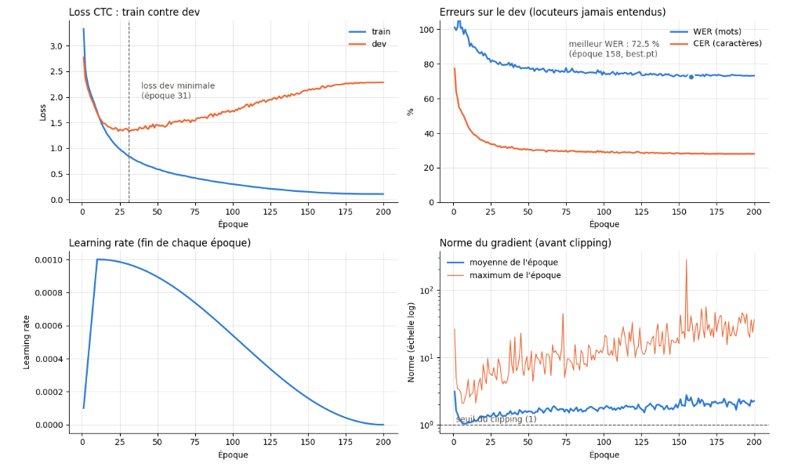

# J-ONE — État d'avancement : reconnaissance vocale avec notre propre Transformer

*Dernière mise à jour : 2 novembre 2026 · Branche `stt-transformer-junior` · Dossier [`recherche/stt_transformer/`](../recherche/stt_transformer/)*

Ce document fait le point, en deux pages, sur la partie **reconnaissance vocale (STT) développée de zéro**. Le détail de chaque étape et de chaque décision est dans le [journal du projet](../recherche/stt_transformer/JOURNAL_PROJET.md). La théorie et le code commenté sont dans les [notions théoriques](../recherche/stt_transformer/NOTIONS_THEORIQUES.md).

## 1. En bref

- **Objectif :** concevoir et entraîner **notre propre modèle Transformer** de reconnaissance vocale en français, sans modèle pré-entraîné, pour comprendre et maîtriser toute la chaîne (données, modèle, entraînement, évaluation). Ensuite viendront l'anglais, puis la synthèse vocale (TTS).
- **Situation :**
  - le pipeline complet fonctionne de bout en bout ;
  - un premier modèle a été entraîné sur GPU (Kaggle) : **WER de 72,5 %** et **CER de 28,0 %** sur des locuteurs jamais entendus ;
  - le modèle **entend** correctement la plupart des sons, mais **orthographie** encore mal les mots, et il **mémorise** les données d'entraînement (overfitting).
- **En cours :** un essai avec **SpecAugment**, une augmentation de données standard contre l'overfitting.
- **Place dans le robot :** ce modèle est un **travail de recherche**. Le pipeline du robot continue d'utiliser **Whisper** ([`jone/stt.py`](../jone/stt.py)) tant que notre modèle n'atteint pas une qualité comparable. La comparaison sera faite avec les mêmes métriques (WER, RTF).

## 2. Ce qui est fait

| Étape | Statut | Résultat principal |
|---|---|---|
| Choix et récupération des données | ✅ | Common Voice FR, *Scripted Speech 26.0* (fr-FR + fr-CA), plus un corpus de parole spontanée pour les tests. Téléchargement via l'API Mozilla Data Collective |
| Analyse exploratoire (EDA) | ✅ | Train : 12 982 clips (environ 19 h, 275 locuteurs). Dev : 484 clips. Test : 285 clips. Choix du vocabulaire (49 caractères + le blank du CTC) |
| Prétraitement audio et texte | ✅ | 16 kHz mono, log-Mel à 80 bandes (fenêtres de 25 ms décalées de 10 ms, mêmes réglages que Whisper), normalisation du texte |
| Modèle | ✅ | Transformer encodeur écrit à la main : sous-échantillonnage ÷ 4 par convolutions, 12 blocs, attention multi-tête, loss CTC. **3,6 M de paramètres.** Chaque bloc a été vérifié contre l'implémentation de référence de PyTorch |
| Test d'overfitting (10 clips) | ✅ | Le modèle apprend 10 phrases par cœur (WER de 3,7 %) : le code d'entraînement est correct |
| Entraînement GPU sur Kaggle | ✅ | 200 époques en 4 h 43, avec sauvegardes et reprise après coupure |
| Métriques | ✅ | WER, CER, losses train et dev, learning rate et norme du gradient, suivis à chaque époque |
| SpecAugment | ✅ code / ⏳ entraînement | Codé et testé, essai d'entraînement à lancer |

## 3. Résultats actuels (modèle de référence)

| Mesure | Valeur | Lecture |
|---|---|---|
| **WER dev** (mots faux) | **72,5 %** (époque 158) | La métrique qui compte pour le robot |
| **CER dev** (lettres fausses) | **28,0 %** | Environ 3 lettres sur 4 sont justes : le son est bien perçu |
| Loss train / dev en fin d'entraînement | 0,11 / 2,29 | **Overfitting** : la loss dev remonte dès l'époque 31 |
| Durée | 1,4 min par époque sur GPU T4 | 40 fois plus rapide que sur le PC |

**Diagnostic :**
1. **Le facteur limitant est la quantité de données.** 19 h, c'est peu : Whisper a été entraîné sur 680 000 h.
2. **Le modèle n'a aucune notion de mot français valide.** Une seule lettre fausse rend le mot entier faux, d'où l'écart entre le WER et le CER.
3. **Presque tout le gain arrive avant l'époque 50.** Les essais suivants seront plus courts.

## 4. Décisions clés

Chaque décision est justifiée dans le journal. Un tableau de synthèse s'y trouve sous le titre « Sur quoi reposent les hyperparamètres de la référence ».

| Sujet | Choix | Raison principale |
|---|---|---|
| Approche | Notre propre Transformer, appris de zéro | Objectif pédagogique et de recherche du projet |
| Loss | CTC, sur des caractères | Simple, adaptée à un encodeur seul, pas besoin d'aligner l'audio et le texte à la main |
| Taille du modèle | « S », 3,6 M de paramètres | Proportionnée à 19 h de données. Un modèle plus gros mémoriserait davantage |
| Calcul | GPU Kaggle (T4, 30 h par semaine) | 23 min pour 400 itérations sur PC, contre 1,4 min pour une époque complète sur T4 |
| Scheduler | Warmup puis décroissance cosinus | Standard actuel. Adoucit les gros gradients du départ |
| Choix du meilleur modèle | Meilleur WER sur le dev | Confirmé après coup : la loss dev aurait gardé un modèle moins bon (80,9 % de WER au lieu de 72,5 %) |
| Lutte contre l'overfitting | SpecAugment d'abord | Le levier standard en STT. Peu de code, aucun changement au modèle |

## 5. Prochaines étapes

1. **Essai 1 : SpecAugment, 80 époques (≈ 1 h 50).** On le compare à la référence (72,5 %).
2. **Selon le résultat :**
   - régler le dropout ;
   - passer au grand dataset (*Scripted Speech 27.0*, environ 1 200 h) ;
   - ajouter un modèle de langue au décodage, pour corriger l'orthographe.
3. **Évaluation finale :**
   - WER sur le **test**, lu et spontané, mesuré une seule fois ;
   - WER par durée de clip ;
   - **RTF** (vitesse par rapport au temps réel) ;
   - **comparaison avec Whisper**, avec les outils de l'équipe (`tools/bench_stt.py`).
4. **Ensuite :** l'anglais, puis la synthèse vocale (TTS).

## 6. Contraintes à connaître

- **Données :** les conditions de Mozilla Data Collective **interdisent de republier le dataset**. Les données ne sont jamais versionnées (`data/` est dans le `.gitignore`), ni publiées sur Kaggle. Les sorties de notebooks contenant des phrases du dataset sont effacées avant chaque push.
- **Clé d'API :** elle est stockée dans un fichier `.env` local, ignoré par git, et dans un *Secret* Kaggle. Elle n'apparaît jamais dans le code.
- **Poids des modèles :** ils sont stockés hors du repo (`runs/` est ignoré).

## 7. Relancer le travail

- **Sur PC :** voir le [README du dossier](../recherche/stt_transformer/README.md) (environnement `uv`, récupération des données).
- **Sur Kaggle :** 4 cellules :
  1. clone de la branche ;
  2. téléchargement des données via le Secret `MDC_API_KEY` ;
  3. préparation ;
  4. boucle d'entraînement.

  Le code des cellules et la marche à suivre (*Save & Run All*) sont dans le journal, aux entrées du 30 octobre et du 2 novembre 2026.

| Fichier | Contenu |
|---|---|
| `stt/text.py` | Normalisation et encodage du texte |
| `stt/audio.py` | Chargement de l'audio et log-Mel |
| `stt/dataset.py` | Dataset, découpages train/dev/test, mise en batch |
| `stt/augment.py` | SpecAugment |
| `stt/model.py` | Le Transformer (pipeline documenté en tête de fichier) |
| `stt/metrics.py` | Décodage CTC, WER, CER |
| `stt/training.py` | Scheduler et évaluation |
| `stt_01` à `stt_03` (notebooks) | Exploration, prétraitement, test d'overfitting |
