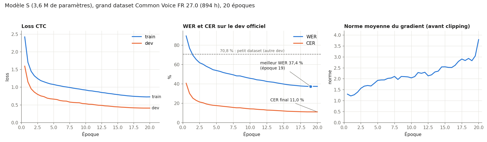

# Journal de projet — STT / TTS pour le robot Unitree G1

**Projet de fin d'études :** Conception d'un système d'interaction homme-robot basé sur l'IA générative et la reconnaissance vocale.
**Responsabilité :** composants STT (Speech-to-Text) et TTS (Text-to-Speech), en français d'abord, puis en anglais.
**Méthode :** Comprendre → Explorer → Expérimenter → Comparer → Décider ensemble.

Ce journal recense chaque avancée, décision et résultat du projet, pour pouvoir rédiger le rapport final. Chaque entrée indique **ce qui a été fait**, **ce qu'on a observé** et **ce qu'on a décidé, avec la justification**.

---

## Environnement de travail

| Ressource | Caractéristiques | Usage |
|---|---|---|
| PC personnel | Windows 10, 4 cœurs, 16 Go de RAM, pas de GPU | Écriture et validation du code, prototypage sur de petits volumes |
| Kaggle Notebooks | GPU NVIDIA Tesla T4 (~15 Go de VRAM), 30 Go de RAM, 30 h de GPU par semaine, sessions de 12 h max, 20 Go conservés dans `/kaggle/working`, ~57 Go de disque par session | Entraînement des modèles |
| Machine GPU de l'équipe | GPU NVIDIA | Option pour les entraînements longs |
| Robot Unitree G1 | — | Intégration finale |

Outils : Python 3.12, gestionnaire de projet `uv`, PyTorch, NumPy, Matplotlib, pandas, VS Code et notebooks Jupyter.

---

## 2026-10-28 — Étape 1 : comprendre le signal audio

Notebook : `TTS.ipynb` (expériences pédagogiques, pas destinées au robot)

### Expérience 1 : forme d'onde d'un signal artificiel

- **Fait :** génération d'une sinusoïde à 440 Hz, échantillonnée à 16 kHz pendant 3 s.
- **Observé :** 48 000 échantillons pour 3 s. Un extrait de 200 échantillons dure 200 / 16 000 = 0,0125 s et contient 440 × 0,0125 = **5,5 cycles**, ce que confirme la courbe.
- **Retenu :**
  - Il ne faut pas confondre la **fréquence du signal** (440 Hz, nombre d'oscillations par seconde) et la **fréquence d'échantillonnage** (16 kHz, nombre de mesures par seconde).
  - D'après le théorème de Nyquist, un échantillonnage à 16 kHz représente correctement les fréquences jusqu'à **8 kHz**. Au-delà apparaît le phénomène d'**aliasing**. Cette bande suffit pour l'essentiel de la voix.

### Expérience 2 : la FFT

- **Fait :** FFT sur une fenêtre de 400 échantillons (25 ms), d'abord sur la sinusoïde à 440 Hz, puis sur un mélange 440 Hz + 1000 Hz (amplitudes 1 et 0,5).
- **Observé :** un pic unique à 440 Hz pour la sinusoïde seule. Pour le mélange, deux pics distincts à 440 Hz et 1000 Hz, de hauteurs 200 et 100, donc dans le même rapport que les amplitudes. La forme d'onde, elle, ne permettait pas de distinguer les deux fréquences.
- **Retenu :** la **résolution fréquentielle** vaut fréquence d'échantillonnage / taille de fenêtre, soit 16 000 / 400 = **40 Hz**. Il existe donc un **compromis temps / fréquence** : une grande fenêtre est précise en fréquence mais floue dans le temps, et inversement.

### Expérience 3 : le STFT et le spectrogramme

- **Fait :** écriture à la main d'un STFT (fenêtres de 25 ms décalées de 10 ms, une FFT par fenêtre), puis comparaison de trois tailles de fenêtre (100, 400 et 1 600 échantillons). Le notebook est prêt, mais les résultats n'ont pas été relevés : la priorité a été donnée au démarrage du projet.
- **Retenu :** le spectrogramme est une matrice **(temps × fréquences)**. C'est le type d'entrée que recevra notre modèle. La représentation **log-Mel** sera étudiée pendant le prétraitement.

---

## 2026-10-28 — Décisions de cadrage

| Décision | Choix | Justification |
|---|---|---|
| Approche | **Concevoir et entraîner nos propres Transformers**, sans utiliser de modèles STT ou TTS tout faits | C'est l'objectif du projet : maîtriser tout le cycle (forward pass, loss, backpropagation, optimisation) |
| Ordre | **STT d'abord**, puis TTS | Le STT est l'entrée de la chaîne homme-robot, et son évaluation (WER) est objective |
| Portée du STT | **Progressive** : d'abord faire fonctionner toute la chaîne sur un petit volume de français libre, puis décider d'élargir (plus de données) ou de spécialiser (commandes du robot) | Valider le pipeline avant d'investir des heures de GPU |
| Accélérateur | **GPU T4** plutôt que TPU | PyTorch standard avec CUDA. Le TPU demande la bibliothèque `torch_xla` et gère mal les entrées de longueur variable, ce qui est le cas de l'audio |
| Plateforme d'entraînement | **Kaggle** (30 h de GPU par semaine) | Gratuit, avec assez de disque pour le dataset complet pendant une session |

---

## 2026-10-28 — Choix et acquisition des données

**Source :** Mozilla Common Voice, distribué depuis octobre 2025 exclusivement par Mozilla Data Collective (MDC). Licence CC0 avec conditions d'utilisation MDC : **interdiction de réhéberger ou de repartager les données**, et interdiction de chercher à identifier les locuteurs.

| Dataset | Taille | Clips | Rôle |
|---|---|---|---|
| CV Scripted Speech 26.0 — French of France (segment) | 167 Mo | 5 490 | Entraînement |
| CV Scripted Speech 26.0 — Canadian French (segment) | 291 Mo | 8 448 | Entraînement (plus d'heures et d'accents variés) |
| CV Spontaneous Speech 5.0 — French | 48,5 Mo | 716 mp3, 688 lignes | Parole naturelle : une partie pour l'entraînement, une partie pour le test, découpé par locuteur |
| CV Scripted Speech 27.0 — French (complet) | 28,55 Go | ~1 200 h | Plus tard, pour l'entraînement réel sur Kaggle |

**Décisions :**
- Les données sont stockées dans `data/`, **exclu de git** à cause de la licence et de la taille.
- **Découpage en trois parts : train / validation / test.**
  - La validation sert aux réglages pendant le développement.
  - Le test n'est utilisé qu'une fois, à la fin, pour le score final.
  - On utilise le découpage officiel de Common Voice (`train.tsv`, `dev.tsv`, `test.tsv`).
- **Découpage par locuteur :** une même voix ne doit jamais apparaître dans deux parts différentes. Sinon le WER mesuré serait trop optimiste, car le modèle aurait déjà entendu ces voix pendant l'entraînement : c'est une **fuite de données**.
- Le dataset spontané sera découpé par locuteur entre entraînement et test, selon sa taille réelle.

---

## 2026-10-29 — EDA (analyse exploratoire des données)

Notebook : `stt_01_exploration.ipynb`

Plan : chaque point doit aboutir à une décision pour le modèle.

1. Transcriptions manquantes
2. Inventaire des caractères (vocabulaire CTC, normalisation du texte)
3. Durée des clips (mémoire GPU, padding)
4. Fréquence d'échantillonnage des mp3 (rééchantillonnage)
5. Rapport longueur du texte / durée de l'audio (contrainte du CTC)
6. Répartition des locuteurs
7. Dataset spontané : découpage et qualité

### Point 1 : transcriptions manquantes — fr-FR train

- **Observé :** 5 086 clips et 13 colonnes. **`sentence` : 0 valeur manquante.**
- `age` (642 manquants), `gender` (1 732) et `variant` (899) sont souvent vides : ces champs sont facultatifs et remplis par les contributeurs eux-mêmes.
- `accents` est toujours rempli, parce que le segment a été construit à partir de cette information.
- `sentence_domain` et `segment` sont presque entièrement vides.
- **Décision :** pour l'entraînement, on ne garde que `path` (le fichier audio), `sentence` (la cible) et `client_id` (le locuteur).

### Point 1 (suite) : fr-CA et dataset spontané

- **fr-CA train :** 8 077 clips, **0 phrase manquante**.
- **Spontané :** 688 lignes, dont **394 sans transcription (57 %)**. Une réponse spontanée doit être transcrite par un humain après coup, et beaucoup ne l'ont pas encore été. La colonne `split` est entièrement vide : Mozilla ne fournit aucun découpage officiel.
- **Données spontanées utilisables :** **294 clips**, **41 locuteurs**, **65 minutes** au total.
- **Répartition très inégale :** le locuteur le plus actif a 45 clips, la moitié des locuteurs en a 3 ou moins, et un quart n'en a qu'un seul.
- **Décision :** on ne conserve que les clips transcrits, et **tout le spontané sert de jeu de test** (option A). Avec 65 minutes, l'ajouter aux ~19 h d'entraînement n'aurait que peu d'effet. En revanche, garder les 294 clips et les 41 locuteurs en test donne une mesure plus fiable du WER sur de la parole naturelle, proche de ce qu'entendra le robot. Un découpage 70 / 30 aurait laissé environ 90 clips en test, ce qui rend le WER instable.
- À vérifier au point 7 : l'écart entre 716 mp3 et 688 lignes. Hypothèse : il s'agit d'enregistrements signalés par la communauté (`ss-reported-audios-fr.tsv`).

### Point 2 : inventaire des caractères et normalisation du texte

- **Observé (train fr-FR + fr-CA, 13 163 phrases) :** **178 caractères différents**.
  - Les majuscules sont comptées à part.
  - Ponctuation variée.
  - Deux apostrophes coexistent : `'` et `’`.
  - Certains accents sont « décomposés » : `e` suivi d'un accent isolé, au lieu d'un seul caractère `é`.
  - On trouve des lettres étrangères (ñ, š, ł…), du grec et des symboles (♫, ∞), souvent vus une seule fois.
  - **Aucun chiffre** : Common Voice fait écrire les nombres en lettres.
- **Problème :** un caractère vu une seule fois ne peut pas être appris, mais il occupe quand même une case dans la sortie du modèle. Majuscules et ponctuation ne s'entendent pas, ou très peu.
- **Décisions de normalisation :**
  - normalisation Unicode **NFC**, qui recolle les accents décomposés ;
  - **tout en minuscules** ;
  - toutes les apostrophes sont unifiées en `'` ;
  - **ponctuation gardée : `. , ? !`**, plus `'` et `-`, qui font partie des mots (« l'homme », « peut-être ») ;
  - la ponctuation secondaire (`; : … « » ( ) —`) est remplacée par **un espace**. Si on la supprimait, deux mots pourraient se retrouver collés (« bonjour;merci » deviendrait « bonjourmerci »). Les espaces en trop sont ensuite réduits à un seul ;
  - les phrases contenant un caractère hors de l'alphabet français sont **écartées**.
- **Résultat :** **181 phrases écartées sur 13 163 (1,4 %)**. Il reste **49 caractères** : 26 lettres, 16 lettres accentuées ou ligatures françaises, l'espace et 6 signes de ponctuation.
- **Conséquence pour le modèle :** l'output head produira **50 scores** à chaque instant : les 49 caractères, plus le **blank** du CTC.

### Choix de la bibliothèque audio

- **Test :** les versions récentes de torchaudio délèguent la lecture des fichiers à TorchCodec, qui exige FFmpeg en version « shared ». Sous Windows, la lecture des mp3 a échoué avec l'installation de FFmpeg présente sur le PC. La bibliothèque **soundfile** (libsndfile 1.2.2) lit en revanche les mp3 sans problème.
- **Décision :** **soundfile pour lire les fichiers audio**, et **torchaudio pour les traitements** (rééchantillonnage, log-Mel). Le même code fonctionne sous Windows et sous Linux (Kaggle), sans installation système.

### Points 3 et 4 : durée des clips et fréquence d'échantillonnage

| | fr-FR | fr-CA | Total |
|---|---|---|---|
| Durée totale | 7,12 h | 11,81 h | **18,93 h** |
| Durée médiane | 4,9 s | 5,2 s | |
| Minimum / maximum | 1,7 s / 10,6 s | 1,5 s / 11,2 s | |
| Fréquences d'échantillonnage | 32 kHz : 3 911 · 48 kHz : 1 161 · 44,1 kHz : 14 | 48 kHz : 4 413 · 32 kHz : 3 664 | **3 fréquences différentes** |

- **Observé :** chaque clip correspond à une seule phrase lue, d'où des durées courtes et homogènes. Les fréquences d'échantillonnage sont hétérogènes : une même seconde de parole ne donne pas le même nombre d'échantillons selon le clip.
- **Décision 1 :** tout **rééchantillonner à 16 000 Hz**.
  - C'est la norme en reconnaissance vocale, ce qui rend nos résultats comparables à ceux de la littérature.
  - D'après le théorème de Nyquist, on conserve les fréquences jusqu'à 8 kHz, ce qui suffit pour la parole.
  - Les données sont 2 à 3 fois plus légères qu'en 32 ou 48 kHz : un clip de 5 s compte 80 000 échantillons au lieu de 240 000.
- **Décision 2 :** **garder tous les clips**. Les durées sont homogènes, et aucun clip ne pose de problème de mémoire. La contrainte du CTC sur les clips courts sera vérifiée au point 5.

### Point 5 : la contrainte du CTC

- **Principe :** le CTC exige que le nombre d'instants de sortie soit **supérieur ou égal** au nombre de caractères de la phrase, plus le nombre de lettres doublées (un blank est obligatoire entre deux lettres identiques). On mesure donc combien d'instants par seconde nos phrases demandent, pour savoir de combien le modèle pourra réduire le nombre d'instants (sous-échantillonnage temporel). Cette réduction allège l'attention, dont le coût croît avec le carré du nombre de positions.

| Instants nécessaires par seconde | fr-FR | fr-CA |
|---|---|---|
| Médiane | 12,7 | 11,8 |
| Maximum | 21,8 | 22,6 |
| Clips impossibles avec ÷ 4 (25 instants/s) | **0** | **0** |
| Clips impossibles avec ÷ 8 (12,5 instants/s) | **2 707 (53 %)** | **3 136 (39 %)** |

- **Conclusion** (avec une analyse à 10 ms, soit 100 instants par seconde) :
  - une réduction **÷ 8 est exclue**, car elle rendrait impossible la transcription de 44 % des clips ;
  - une réduction **÷ 4 est possible**, mais la marge est faible : 25 instants/s disponibles, pour un maximum observé de 22,6 ;
  - une réduction ÷ 2, ou aucune réduction, laisse une marge confortable, mais coûte plus cher en calcul.
- **Décision reportée** à la conception de l'architecture : le choix se fera entre ÷ 2 et ÷ 4.
- **À vérifier :** un clip ne demande que 1,05 instant par seconde. C'est peut-être un long silence, ou un texte qui ne correspond pas à l'audio.

### Point 6 : répartition des locuteurs

| | fr-FR | fr-CA |
|---|---|---|
| Locuteurs différents | 106 | 169 |
| Clips par locuteur (médiane) | 14,5 | 18 |
| Locuteur le plus actif | 505 clips (≈ 10 % du dataset) | 909 clips (≈ 11 %) |
| Part des 10 locuteurs les plus actifs | **53,8 %** | **43,6 %** |

- **Observé :** il y a peu de voix différentes (275 locuteurs en entraînement, contre environ 21 000 dans le dataset complet), et leur répartition est très déséquilibrée. C'est typique de Common Voice, où quelques bénévoles très actifs enregistrent la majorité des phrases.
- **Risque :** le modèle risque de s'adapter aux voix dominantes, ce qui serait une forme d'overfitting sur les locuteurs. Les jeux de dev et de test, composés d'autres locuteurs, permettront de le détecter.
- **Options étudiées :**
  - A. Tout garder.
  - B. Plafonner à 200 clips par locuteur : −17,7 % de clips.
  - C. Plafonner à 100 clips par locuteur : −35,2 % de clips.
  - D. Échantillonnage pondéré pendant l'entraînement.
- **Décision : A, tout garder pour le prototype.** Avec 19 h de données, chaque clip compte, et le prototype sert d'abord à valider la chaîne complète. Le déséquilibre sera beaucoup plus faible avec le dataset complet (MDC, 28,5 Go). Si l'écart de WER entre train et dev est important, l'option D sera la première piste à essayer.

### Point 7 : dataset spontané (fichiers, qualité, conventions de transcription)

- **716 mp3 pour 688 lignes :** les 28 mp3 en trop sont exactement les 28 enregistrements **signalés** par la communauté (`ss-reported-audios-fr.tsv`) : 27 pour une réponse dans une autre langue, 1 pour une autre raison. Ils sont déjà exclus du tableau principal.
- **Étiquettes de qualité (294 clips transcrits) :** 49 clips sont marqués `transcription-length` (transcription anormalement courte pour la durée de l'audio, donc probablement incomplète), dont 2 également `short-audio`.
- **Conventions de transcription différentes de la parole lue :**
  - annotations entre crochets dans 44 transcriptions : `[disfluency]`, `[noise]`, `[toux]`, `[no sound]`, `[unclear]`, `[pas clair]` ;
  - chiffres dans 6 transcriptions ;
  - hésitations « euh » dans 26 transcriptions.
  - Notre normalisation en écartait 54 sur 294.
- **Durées beaucoup plus longues** que pour l'entraînement : médiane de 8,9 s, maximum de **83 s**, et 25 % des clips au-delà de 17 s. Les clips d'entraînement ne dépassent pas 11,2 s. Or un Transformer généralise souvent mal à des longueurs jamais vues.

**Règles d'évaluation décidées pour le jeu de test spontané :**

| Règle | Justification |
|---|---|
| Écarter les 49 clips `transcription-length` | Une référence incomplète pénaliserait le modèle pour des mots réellement prononcés |
| Écarter les clips contenant `[unclear]` ou `[pas clair]` | Passage incompréhensible, donc référence incomplète |
| Écarter les clips contenant des chiffres | L'entraînement n'en contient aucun : le modèle ne peut pas en produire |
| Supprimer `[noise]`, `[toux]`, `[disfluency]` et `[no sound]` des références | Ce ne sont pas des mots. Le spontané sert uniquement au test : le modèle n'apprendra jamais ces étiquettes, qui ne feraient que gonfler le WER |
| Retirer les « euh » des références | Pratique courante en évaluation STT : on mesure les mots porteurs de sens. Un modèle entraîné sur de la parole lue ne connaît pas « euh » |
| Garder les clips longs, et calculer le WER **par tranche de durée** (moins de 11 s, de 11 à 30 s, plus de 30 s) | Mesurer et documenter l'effet de la longueur, plutôt que de le cacher |

**Jeu de test spontané final :** **230 clips**, **38 locuteurs**, **50,8 minutes**. Répartition par durée : 131 clips de moins de 11 s, 79 de 11 à 30 s, et 20 de plus de 30 s.

**Piste d'amélioration future :** détecter les hésitations, les bruits et la toux, ce qui serait utile pour l'interaction avec le robot. Cela demanderait des données d'**entraînement** annotées pour ces événements, par exemple nos propres enregistrements avec le robot.

---

## 2026-10-29 — Organisation du code dans le dépôt de l'équipe

- **Dépôt de l'équipe :** [mohamed-943/projet-J-ONE](https://github.com/mohamed-943/projet-J-ONE), un dépôt public. Il contient déjà un pipeline vocal de production pour le robot (Silero VAD → Whisper turbo → LLM → Piper TTS).
- **Décision :** notre travail est un **axe de recherche** mené à côté de ce pipeline. Il est placé sur la branche `stt-transformer-junior`, dans le dossier `recherche/stt_transformer/`, avec son propre environnement `uv`. Il ne modifie rien dans `jone/`.
- **Intérêt pour le rapport :** on pourra comparer notre modèle à Whisper (WER, latence, ressources) sur le même jeu de test.
- **Précaution :** les données ne sont pas versionnées, et les sorties de notebook qui affichent de vraies lignes de Common Voice sont effacées avant chaque envoi sur GitHub, conformément à la licence MDC.

---

## 2026-10-29 — Prétraitement audio

Notebook : `stt_02_pretraitement.ipynb`. On suit un seul clip, étape par étape.

| Étape | Outil | Forme du tenseur (clip de 4,656 s) |
|---|---|---|
| 1. Lecture du mp3 | `soundfile`, puis `torch.from_numpy` | `(223488,)` à 48 kHz |
| 2. Rééchantillonnage à 16 kHz | `torchaudio.functional.resample` : filtre passe-bas anti-aliasing, puis réduction du nombre d'échantillons | `(74496,)`, soit un rapport de 3 |
| 3. Spectrogramme log-Mel | `torchaudio.transforms.MelSpectrogram`, puis `log(x + 1e-6)`, puis transposition | `(466, 80)` = (instants, caractéristiques) |

- **Décision sur les paramètres du log-Mel :** fenêtre de **25 ms** (400 échantillons), pas de **10 ms** (160 échantillons, soit 100 instants par seconde), **80 bandes Mel**. C'est le standard de la reconnaissance vocale, avec les mêmes réglages que Whisper, ce qui rend la comparaison plus juste.
- **Nombre d'instants :** 1 + ⌊74 496 / 160⌋ = 466. torchaudio centre la première fenêtre sur l'échantillon 0.
- **Valeurs observées :** minimum −13,8 (= log(1e‑6), donc des bandes d'énergie nulle), maximum 6,6, moyenne −7,8, écart-type 5,6. Les valeurs ne sont pas centrées : une **normalisation** est à décider.

| Étape | Outil | Résultat |
|---|---|---|
| 4. Normalisation par clip | Moyenne et écart-type de chaque bande Mel, calculés sur les instants du clip (`dim=0`), puis `(x − moyenne) / (écart-type + 1e‑5)` | Forme inchangée `(466, 80)`, moyenne ≈ 0, écart-type ≈ 1 |
| 5. Encodage du texte | Vocabulaire de **50 symboles** : le blank (indice 0, valeur par défaut de `nn.CTCLoss`), puis les 49 caractères triés (indices 1 à 49) | Phrase de 61 caractères → tenseur `(61,)`. Le décodage redonne exactement le texte. |

- **Décision sur la normalisation :** **par clip**, plutôt que globale ou à formule fixe (façon Whisper).
  - Elle compense les différences de micro et de volume entre les enregistrements, ce qui est essentiel pour passer de Common Voice au micro du robot.
  - Sur le robot, le VAD fournit de toute façon des énoncés complets à normaliser.
- **Vérification de la contrainte du CTC sur ce clip :** 61 caractères + 2 lettres doublées (« rr », « ss ») = **63 instants nécessaires**.
  - Avec une réduction ÷ 4, on dispose de 466 / 4 ≈ 116 instants : la contrainte est respectée.
  - Avec ÷ 8, on n'en aurait que ≈ 58, ce qui la rend impossible. C'est cohérent avec le point 5 de l'EDA.

### Organisation du code : un module Python

- **Décision :** le code validé est rangé dans un module `stt/`, que les notebooks importent. On évite ainsi de recopier les fonctions d'un notebook à l'autre, avec le risque d'incohérence que cela comporte. Ce même module servira à lancer l'entraînement sur Kaggle, puis à l'intégration dans le robot. C'est aussi l'organisation qu'utilise l'équipe dans `jone/`.
  - `stt/text.py` : `normalize`, `is_valid`, le vocabulaire (`VOCAB`, `CHAR_TO_ID`, `ID_TO_CHAR`), `encode` et `decode`.
  - `stt/audio.py` : `load_audio` (lecture du mp3, passage en mono, rééchantillonnage à 16 kHz) et `log_mel` (log-Mel puis normalisation par clip).
- **Vérification :** sur le clip étudié, le module donne exactement le même résultat que les cellules du notebook (features égales à 1e‑5 près, cible identique).

### Dataset PyTorch

- `stt/dataset.py` contient deux éléments :
  - `load_split(folders, split)` assemble les fichiers `.tsv` d'un découpage pour plusieurs segments, normalise le texte, écarte les phrases non valides et garde les colonnes `audio_path`, `text` et `client_id` ;
  - `CommonVoiceDataset` est une classe qui hérite de `torch.utils.data.Dataset`. Sa méthode `__getitem__` prétraite chaque clip **au moment où on le demande**, sans garder tous les spectrogrammes en mémoire.
- **Tailles obtenues :** train = **12 982 clips** (13 163 − 181 phrases écartées), dev = **484 clips**, test (lu) = 285 clips.
- **Optimisation possible plus tard :** précalculer les features et les enregistrer sur disque, si le calcul du log-Mel à chaque époque ralentit l'entraînement sur Kaggle.

### DataLoader et padding

- `collate_batch` (dans `stt/dataset.py`) assemble les clips d'un batch :
  - elle complète les features et les cibles avec des 0 jusqu'à la longueur maximale du batch, avec `pad_sequence(batch_first=True)` ;
  - elle renvoie aussi les **vraies longueurs**, nécessaires au CTC et au masque d'attention.
  - Les 0 ajoutés aux cibles ne posent pas de problème : le CTC lit `target_lengths` et ignore ce qui dépasse.
- **Exemple de batch de 8 clips :** features `(8, 757, 80)`, cibles `(8, 87)`. Les longueurs réelles vont de 389 à 757 instants.
- **Observation :** le clip le plus court du batch est composé à **49 % de padding**, ce qui représente du calcul gaspillé. Une piste d'optimisation consisterait à regrouper les clips de longueurs proches dans un même batch (*bucketing*).

---

## 2026-10-29 — Modèle : bloc 1, sous-échantillonnage

Fichier : `stt/model.py`.

- **Décision :** sous-échantillonnage par **deux convolutions 2D** (filtre 3 × 3, pas de 2, chacune suivie d'une ReLU), puis une projection linéaire vers `d_model`. Le nombre d'instants est ainsi divisé par environ 4.
- **Options écartées :**
  - une convolution 1D avec réduction ÷ 2 : plus simple, mais l'attention coûte 4 fois plus cher ;
  - l'empilement de 4 instants suivi d'un `nn.Linear` : n'apprend pas de motifs locaux.
- **Justification :**
  - le coût de l'attention est divisé par 16 ;
  - la réduction ÷ 4 respecte la contrainte du CTC mesurée à l'EDA (au maximum 22,6 instants nécessaires par seconde, pour 25 disponibles) ;
  - c'est la méthode standard des modèles STT récents.
- **Test** (avec les valeurs provisoires `channels=32` et `d_model=144`) :
  - un batch `(8, 663, 80)` devient `(8, 165, 144)` ;
  - les vraies longueurs sont réduites avec la même formule, par exemple 315 → 78 ;
  - calcul à la main : ⌊(663 − 3) / 2⌋ + 1 = 331, puis ⌊(331 − 3) / 2⌋ + 1 = 165. Le résultat est conforme.

## 2026-10-29 — Modèle : bloc 2, encodage des positions

- **Options étudiées :**
  - A. Sinusoïdal (Transformer original) ;
  - B. Appris (une table de positions) ;
  - C. Relatif ou rotatif (RoPE).
- **Décision : A, sinusoïdal.**
  - Il est simple et ne demande aucun paramètre à apprendre.
  - Il est défini pour toutes les longueurs. C'est nécessaire, car le test spontané va jusqu'à 83 s, alors que l'entraînement s'arrête à 11 s. L'option B en serait incapable.
  - **Critère pour changer :** si le WER se dégrade fortement sur la tranche de plus de 30 s, on passera à l'option C. Cela constituera une expérience comparative pour le rapport.
- **Test :** la forme est inchangée `(8, 153, 144)`, le module a 0 paramètre appris, et la position 0 vaut `[0, 1, 0, 1, …]`.

## 2026-10-29 — Modèle : bloc 3, attention

- **Options étudiées :**
  - A. Écrire l'attention à la main ;
  - B. Utiliser directement les modules de PyTorch ;
  - C. Les deux.
- **Décision : C.**
  - On écrit chaque composant à la main pour le comprendre.
  - On le **vérifie contre l'équivalent PyTorch** avec un test de référence.
  - On entraîne avec les versions optimisées de PyTorch, ce qui correspond aux standards professionnels (rapidité, fiabilité).
- **Morceau 1, attention à une tête et masque du padding :**
  - fonctions `make_padding_mask` et `scaled_dot_product_attention` dans `stt/model.py` ;
  - test : le padding reçoit un poids de 0, chaque ligne de poids somme à 1, et la sortie est **identique à `F.scaled_dot_product_attention`**.
- **Morceau 2, multi-head attention :**
  - classe `MultiHeadSelfAttention` : Q, K et V sont produits par une seule couche linéaire, la séquence est découpée en têtes, puis recollée, puis passe dans une projection de sortie ;
  - l'option `use_pytorch_kernel` choisit entre notre attention et la version optimisée ;
  - test : sortie `(2, 4, 144)`, **identique à `nn.MultiheadAttention`** (après copie des mêmes poids) et identique à la version optimisée.
- **Morceaux 3 et 4, feed-forward et bloc complet :**
  - **Décisions :**
    - **pre-norm** plutôt que post-norm, pour la stabilité de l'entraînement de zéro avec un budget GPU limité ; c'est aussi le choix de Whisper et des modèles récents ;
    - **GELU**, le standard des Transformers ;
    - **dropout de 0,1**, à cause du risque d'overfitting avec seulement 275 locuteurs (EDA, point 6).
  - Classes `FeedForward` (Linear → GELU → Dropout → Linear) et `TransformerBlock`, qui calcule x + Attention(LayerNorm(x)), puis x + FFN(LayerNorm(x)).
  - **Test :** le résultat est **identique à `nn.TransformerEncoderLayer(norm_first=True, activation="gelu")`**, avec les mêmes poids et en mode `.eval()`.
- **Notions :** `NOTIONS_THEORIQUES.md` contient désormais, pour chaque notion, le morceau de code retenu avec ses commentaires.

## 2026-10-29 — Modèle complet : `SpeechTransformer`

- **Décision sur la taille : « S »**, soit `d_model = 144`, 12 blocs, 4 têtes, `d_ff = 576`, 144 canaux de convolution et **3,60 M de paramètres**.
  - **Configurations comparées :** XS (1,7 M), S (3,6 M), M (11,3 M), L (45,2 M ≈ Whisper tiny).
  - **Justification :** avec 19 h de données et 275 locuteurs, un modèle plus gros risquerait de mémoriser les données plutôt que de généraliser. La taille S permet aussi des entraînements rapides, donc plusieurs essais dans les 30 h de GPU hebdomadaires. On passera à M ou L avec le dataset complet (MDC, environ 1 200 h).
- **Organisation de `stt/model.py` :** le fichier se lit de haut en bas dans l'ordre du pipeline. L'en-tête du fichier indique d'où viennent les données (`audio.py`, `text.py`, `dataset.py`) et où elles vont (loss CTC). La classe `SpeechTransformer`, placée en bas du fichier, assemble les étapes.
- **Éléments ajoutés à l'assemblage :**
  - une **LayerNorm finale** : en pre-norm, la sortie du dernier bloc n'est jamais normalisée ;
  - une **output head** `Linear(144 → 50)` ;
  - un **`log_softmax`**, parce que `nn.CTCLoss` attend des log-probabilités ;
  - une **`nn.ModuleList`** pour les blocs, afin que PyTorch suive leurs paramètres.
- **Test sur un vrai batch :**
  - l'entrée `(8, 627, 80)` donne une sortie `(8, 156, 50)` ;
  - la contrainte du CTC est respectée pour les 8 clips (par exemple 94 instants pour 55 caractères) ;
  - les probabilités somment à 1 à chaque instant.

## 2026-10-29 — Test d'overfitting sur 10 clips (PC, CPU)

Notebook : `stt_03_overfit_10_clips.ipynb`.

- **But :** vérifier que tout le pipeline peut **apprendre** : forward, loss CTC, backpropagation et optimizer. On entraîne sur 10 clips seulement : le modèle doit les apprendre par cœur. Ici, l'overfitting est **voulu**.
- **Réglages :**
  - modèle de taille S (3,6 M de paramètres) ;
  - un seul batch de 10 clips, de forme `(10, 595, 80)`, avec des phrases de 21 à 88 caractères ;
  - optimizer AdamW, learning rate de 1e‑3 ;
  - *gradient clipping* à 1 ;
  - 400 itérations.
- **Fonctions ajoutées dans le notebook** (à ranger dans `stt/` après validation) :
  - `greedy_decode` : argmax, puis fusion des répétitions, puis suppression des blanks ;
  - `edit_distance` ;
  - `error_rate`, qui calcule le WER et le CER.
- **Piège évité :** `nn.CTCLoss` attend le temps en premier, `(T', B, C)`. D'où le `log_probs.transpose(0, 1)`.

| Itération | Loss | WER | CER | Phrase prédite pour le 1er clip | Phase |
|---|---|---|---|---|---|
| 1 | 6,41 | 100 % | 124 % | lettres aléatoires | Modèle non entraîné |
| 25–50 | 3,06 → 2,92 | 100 % | 89 → 85 % | vide (que des blanks) | Phase normale du CTC : le blank est appris en premier |
| 75–100 | 2,62 → 1,73 | ≈ 100 % | 68 → 58 % | « i e art earnie… » | Premiers sons et mots courts |
| 125–200 | 0,65 → 0,08 | 72 → 12 % | 22 → 3 % | « il est planté de marronirs… » | Apprentissage rapide |
| 225–400 | ≈ 0,02–0,05 | 6–14 % | 1–2 % | quasi exact | Plateau. Les petites oscillations viennent du dropout, actif en mode `.train()`. |
| **Final (`.eval()`)** | — | **3,7 %** | **0,6 %** | identique à la référence | |

- **Diagnostic : ✅ le test est réussi.**
  - La loss descend de 6,4 à environ 0,02, sans `nan`.
  - La norme du gradient reste raisonnable (pic de 18,7 à la 1re itération seulement, puis entre 0,2 et 2).
  - Les phrases sont recopiées. Exemple : « il est enterré au forest lawn memorial park cemetery à glendale en californie. »
  - **Le code peut apprendre. On peut passer à l'entraînement réel sur Kaggle.**
- **Remarques :**
  - Le CER de 124 % à la 1re itération et le WER de 109,9 % à l'itération 75 dépassent 100 %. C'est possible, parce que les **insertions** (des mots ou caractères en trop) comptent comme des erreurs.
  - **Durée : 1 407 s (≈ 23 min) pour 400 itérations sur CPU**, soit environ 3,5 s par itération sur 10 clips. Une seule époque sur les 12 982 clips prendrait des heures sur CPU. Cela confirme le besoin du GPU de Kaggle.

## 2026-10-29 — Module `stt/metrics.py`

- **Décision :** les trois fonctions du test d'overfitting ont été **validées**. Elles sont rangées dans `stt/metrics.py` (`greedy_decode`, `edit_distance`, `error_rate`) pour être réutilisées par l'entraînement sur Kaggle. Le notebook `stt_03` les importe désormais depuis ce module.
- **Vérification sur des exemples connus :**
  - « chat » → « chats », « chot » et « cht » : 1 erreur chacun ;
  - « le chat dort » → « le chien dort » : WER de 33,3 % ;
  - la sortie `_aa_ab__` est décodée en « aab ». Avec une longueur de 3, on obtient « a », ce qui montre que le padding est bien ignoré.
- **Notions ajoutées :** 20 (décodage glouton du CTC), 21 (distance d'édition, WER, CER), 22 (test d'overfitting et boucle d'entraînement).

## 2026-10-30 — Mise en place sur Kaggle et choix du scheduler

- **Réglages Kaggle :**
  - Secret `MDC_API_KEY` ajouté (la clé n'apparaît jamais dans le code) ;
  - accélérateur GPU T4 et Internet activés.
- **Cellule 1 :** clone de la branche `stt-transformer-junior` (75 fichiers, 238 Ko, sans les données). Le GPU est confirmé : Tesla T4.
- **Cellule 2 :** téléchargement depuis MDC des archives fr-FR (167 Mo), fr-CA (291 Mo) et du corpus spontané (49 Mo), en environ 7 s.
  - Les données sont décompressées dans `/tmp/data`, un dossier non sauvegardé avec le notebook : les conditions MDC interdisent de republier le dataset.
  - Un lien `data → /tmp/data` permet de garder les mêmes chemins que sur le PC.
- **Cellule 3, mesure de vitesse** (30 itérations, batch de 32, `num_workers=4`) :

| | PC (CPU) | Kaggle (T4) |
|---|---|---|
| Une itération | 3,5 s pour 10 clips | 0,29 s pour 32 clips |
| Une époque (12 982 clips, 406 itérations) | ≈ 75 min | **≈ 2 min** |
| Mémoire GPU maximale | — | 1,7 Go sur 15 Go |

- **Décision : 200 époques** (≈ 7 h, soit 81 200 itérations).
  - Le quota hebdomadaire de Kaggle n'est pas une contrainte.
  - Les risques sont couverts par des sauvegardes régulières (reprise après une coupure) et par l'early stopping sur le WER dev.
- **Décision : le scheduler A, warmup puis décroissance cosinus** (contre Noam et un learning rate constant), avec ces réglages :
  - learning rate maximum de 1e‑3 ;
  - warmup de 5 %, soit 4 060 itérations (≈ 10 époques).

  Raisons :
  - c'est le standard actuel ;
  - la durée totale de l'entraînement est connue ;
  - le warmup adoucit le pic de gradient du départ (18,7 dans le test d'overfitting) ;
  - la fin en douceur permet d'affiner le modèle.
- **Vérification avec le vrai `LambdaLR` de PyTorch :**
  - learning rate de 2,46e‑07 à l'itération 0 ;
  - 1,00e‑03 à la fin du warmup ;
  - 5,00e‑04 à l'époque 105 ;
  - 4,15e‑13 à la fin.

  Les quatre valeurs sont celles calculées à l'avance. La courbe a la forme attendue.

## 2026-10-30 — Essai de la boucle complète sur Kaggle (2 époques)

- **Boucle :**
  - forward → loss CTC → backward → clipping → `optimizer.step()` → `scheduler.step()` ;
  - à la fin de chaque époque, `evaluate` mesure le dev (16 batchs).
- **Sauvegardes à chaque époque :**
  - `best.pt` : le meilleur WER dev, pour l'early stopping ;
  - `last.pt` : modèle, optimizer, scheduler, époque et historique, pour la reprise ;
  - `history.json` : pour tracer les courbes.
- **Résultats de l'essai :**

| Époque | Loss train | Loss dev | WER dev | CER dev | Durée |
|---|---|---|---|---|---|
| 1 | 2,70 | 2,32 | 101,0 % | 61,0 % | 1,5 min |
| 2 | 2,26 | 2,16 | 100,4 % | 57,0 % | 1,5 min |

- **Observations :**
  - La phase des blanks est dépassée dès la 1re époque : des syllabes sont reconnaissables (« pré », « de l'ère »).
  - La loss dev est plus basse que la loss train. C'est normal : la loss train est une moyenne sur l'époque, avec dropout, alors que la loss dev est mesurée à la fin, sans dropout.
  - Le pic de gradient du départ (22,7) est absorbé par le warmup et le clipping.
  - **Durée réelle : 1,5 min par époque**, donc 200 époques ≈ 5 h.
- **Incident instructif :** la boucle a été relancée sans réinitialiser `start_epoch`. Le learning rate est alors **remonté** de 0 à 9,9e‑4 : au-delà de la fin, la formule du cosinus remonte. Pendant ce temps, le modèle a continué d'apprendre (CER dev de 54,3 % après 4 époques au total).
- **Test de reprise ✅ :** en relançant la cellule de préparation, on lit `départ à l'époque 3`. La sauvegarde `last.pt` est donc bien relue.

## 2026-11-02 — Premier entraînement complet : taille S, 200 époques (Kaggle T4)

- **Lancement :** *Save & Run All* (exécution en arrière-plan), 4 cellules : clone → téléchargement MDC → préparation → boucle.
  - **1er essai échoué en 2 min :** les cellules du clone et du téléchargement avaient été supprimées. Dans une machine neuve, ni `stt/` ni les données n'existent. Après les avoir remises, l'entraînement a tourné jusqu'au bout.
- **Durée :** 1,4 min par époque, soit **≈ 4 h 40** pour 200 époques. Pas de `NaN`, pas de coupure.

| Époque | Loss train | Loss dev | WER dev | CER dev | Learning rate | Remarque |
|---|---|---|---|---|---|---|
| 1 | 3,33 | 2,77 | 101,1 % | 77,3 % | 1,0e‑4 | Début du warmup |
| 10 | 1,71 | 1,69 | 95,4 % | 43,7 % | 1,0e‑3 | Fin du warmup |
| 20 | 1,14 | 1,38 | 84,7 % | 35,4 % | 9,9e‑4 | |
| 31 | 0,85 | **1,34** | 80,9 % | 32,6 % | 9,7e‑4 | **Loss dev minimale** |
| 50 | 0,59 | 1,46 | 78,0 % | 30,5 % | 8,9e‑4 | |
| 100 | 0,30 | 1,73 | 75,3 % | 29,3 % | 5,4e‑4 | |
| **158** | 0,14 | 2,16 | **72,5 %** | **28,0 %** | 1,2e‑4 | **Meilleur WER dev → `best.pt`** |
| 200 | 0,11 | 2,29 | 73,2 % | 28,0 % | 0 | Fin |

- **Observations :**
  1. **Overfitting net.**
     - La loss train descend jusqu'à 0,11, alors que la loss dev **remonte** à partir de l'époque 31, de 1,34 à 2,29.
     - Le modèle mémorise les phrases et les voix du train : 19 h de parole et 275 locuteurs, c'est peu pour 3,6 M de paramètres.
  2. **La loss dev et le WER divergent.** Malgré la remontée de la loss dev, le WER dev continue de baisser lentement : 80,9 % à l'époque 31, 72,5 % à l'époque 158. La loss CTC punit très fort les erreurs commises **avec certitude**. Le modèle devient trop sûr de lui sur ses erreurs, ce qui fait monter la loss, tout en prenant un peu plus de bonnes décisions, ce qui fait baisser le WER.
     - **Conclusion :** choisir le meilleur modèle sur le **WER** (notre choix) plutôt que sur la loss dev était le bon critère.
  3. **Rendements décroissants.**
     - La quasi-totalité du gain arrive avant l'époque 50 (WER 78 %).
     - Les 150 époques suivantes ne font gagner que 5,5 points.
  4. **CER de 28 %, WER de 73 %.**
     - Le modèle **entend** correctement la plupart des sons : la phrase prédite est phonétiquement proche.
     - En revanche, il **orthographie mal** : lettres muettes, accords, mots coupés ou collés.
     - Un modèle CTC par caractères, **sans modèle de langue**, n'a aucune notion de ce qu'est un mot français valide : une seule lettre fausse suffit à rendre le mot entier faux.
  5. **Norme du gradient.**
     - La moyenne monte lentement, de 1,0 à environ 2,2.
     - Il y a des pics isolés : 282 à l'époque 155, 44,5 à l'époque 73.
     - Le clipping à 1 les absorbe : aucun effet visible sur les métriques.
- **Bilan honnête :** un WER dev de 72,5 % est **moins bon** que l'estimation faite avant l'entraînement (30 à 60 %). Le pipeline fonctionne de bout en bout, mais le modèle ne généralise pas encore assez. **Le facteur limitant est la quantité de données**, pas le code.
- **Figure :** `figures/courbes_s_200ep.png`, avec 4 graphiques : losses train/dev, WER/CER dev, learning rate et norme du gradient (échelle log).
  - **Loss :** l'écart entre train et dev se creuse après l'époque 31. C'est la signature de l'overfitting.
  - **WER / CER :** une chute rapide jusqu'à l'époque 25 environ, puis un plateau.
  - **Learning rate :** la courbe est identique à celle prévue.
  - **Gradient :** la moyenne monte de 1,1 à 2,3 et les pics grandissent. C'est un autre signe de mémorisation, absorbé par le clipping.

## Synthèse — Sur quoi reposent les hyperparamètres de la référence (*baseline*)

Les **paramètres** sont les 3,6 M de poids du modèle : ils sont **appris** par l'optimizer. Les **hyperparamètres** sont les réglages **choisis par nous** avant l'entraînement. Ce tableau rassemble chaque choix et sa justification, avec l'endroit où elle a été établie. La référence donne un **WER dev de 72,5 %** (époque 158).

| Hyperparamètre | Valeur | Sur quoi on s'est basé | Où |
|---|---|---|---|
| Fréquence d'échantillonnage | 16 kHz | La voix utile est sous 8 kHz (Nyquist). C'est le standard STT, et celui de Whisper | EDA, prétraitement |
| Log-Mel | fenêtre de 25 ms, pas de 10 ms, 80 bandes | Standard de la reconnaissance vocale, mêmes réglages que Whisper, ce qui rend la comparaison juste | Prétraitement |
| Sous-échantillonnage | ÷ 4 (deux Conv2D à pas de 2) | Contrainte du CTC mesurée à l'EDA : au plus 22,6 instants nécessaires par seconde, pour 25 disponibles après ÷ 4. Le coût de l'attention est divisé par 16 | EDA, modèle bloc 1 |
| Taille du modèle | « S » : `d_model` 144, **12 blocs**, 4 têtes, `d_ff` 576, soit 3,6 M de paramètres | Comparaison XS / S / M / L. Avec 19 h et 275 locuteurs, un modèle plus gros mémoriserait. Valeurs proches de Conformer-S. `d_ff` = 4 × `d_model` (ratio standard du Transformer) | Modèle complet (`stt/model.py`, valeurs par défaut de `SpeechTransformer`) |
| Dropout | 0,1 | Valeur de l'article original du Transformer, choisie à cause du risque d'overfitting (275 locuteurs, EDA point 6) | Modèle bloc 3 |
| Optimizer | AdamW | Standard pour entraîner un Transformer. *Weight decay* à 0,01 (valeur par défaut de PyTorch, **non réglée**) | Test d'overfitting |
| Learning rate maximum | 1e‑3 | Le test d'overfitting a montré que le modèle apprend bien à cette valeur (loss de 6,4 à 0,02). Valeur **non réglée sur le dev** | Test d'overfitting |
| Scheduler | Warmup de 5 % (≈ 10 époques), puis cosinus | Pic de gradient de 18,7 au départ (test d'overfitting). Durée totale connue. Standard actuel | Choix du scheduler |
| Gradient clipping | norme maximale de 1 | Valeur courante. Absorbe les pics observés : 18,7 dans le test d'overfitting, jusqu'à 282 dans l'entraînement complet | Test d'overfitting |
| Taille de batch | 32 | Mesure sur T4 : 1,7 Go utilisés sur 15 Go. Ça donne 406 itérations par époque | Mesure de vitesse |
| Nombre d'époques | 200 | 1,4 min par époque mesurée, et le quota Kaggle n'était pas une contrainte. **Le résultat montre que 50 à 80 époques suffisent** : presque tout le gain arrive avant l'époque 50 | Mesure de vitesse, puis résultats |
| Critère d'early stopping | Meilleur **WER** dev | C'est la métrique qui compte. Confirmé après coup : la loss dev était minimale à l'époque 31 (WER 80,9 %), alors que le meilleur WER est à l'époque 158 (72,5 %) | Boucle d'entraînement, puis résultats |

**Ce qui n'a pas encore été réglé :** le learning rate, le dropout, le *weight decay* et la taille du modèle ont été fixés une seule fois, **sans comparaison sur le dev**. C'est l'objet de l'étape d'optimisation qui suit. Une seule modification par essai, comparée à cette référence.

## 2026-11-02 — Optimisation, essai 1 : choix de SpecAugment

**Point de départ (raisonnement) :**
- **Problème mesuré sur la référence :** un overfitting fort. La loss dev remonte dès l'époque 31 (de 1,34 à 2,29), alors que la loss train descend à 0,11.
- **Leviers envisagés :**
  - A. SpecAugment ;
  - B. plus de données ;
  - C. un modèle de langue au décodage ;
  - D. un dropout plus fort ;
  - E. un modèle plus petit.
- **Choix : SpecAugment.**
  - C'est le levier standard de la reconnaissance vocale contre l'overfitting.
  - Il ne change pas le modèle, seulement les données vues à l'entraînement.
  - Il est peu coûteux à mettre en place.
  - Plus de données (B) viendra une fois qu'on aura une recette qui généralise mieux. Le modèle de langue (C) corrigerait l'orthographe, mais pas ce que le modèle entend.
- **Méthode :** une seule modification par essai par rapport à la référence. Le dropout reste à 0,1 (SpecAugment et dropout agissent à des endroits différents : l'entrée et l'intérieur du réseau, et ils se combinent dans les recettes professionnelles). Les essais seront plus courts (80 époques au lieu de 200), puisque la référence a montré que presque tout le gain arrive avant l'époque 50.

**Décision 1 : écrire les masques nous-mêmes** plutôt qu'utiliser `torchaudio.transforms.FrequencyMasking` / `TimeMasking`.
- torchaudio attend le format `(fréquences, temps)`, alors que nos features sont en `(temps, 80)`. Un transpose oublié masquerait les mauvais axes sans aucune erreur visible.
- Le code fait une dizaine de lignes, toutes validables.
- C'est cohérent avec le choix d'écrire l'attention nous-mêmes.

**Décision 2 : des masques de taille « moyenne ».**
- **Fréquences :** 2 masques de 0 à 27 bandes Mel chacun, sur 80. Valeur de la recette de référence (Park et al., 2019, *SpecAugment*, politique *LibriSpeech Double*).
- **Temps :** 2 masques de 0 à 40 instants chacun (0,4 s), **et au plus 10 % de la durée du clip.**
- **Options écartées :**
  - **Léger** (1 masque de chaque type, plus petits) : effet probablement trop faible face à un overfitting aussi marqué.
  - **Fort** (la recette originale, masques de temps jusqu'à 1 s) : elle a été conçue pour LibriSpeech, dont les clips durent 10 à 15 s. Sur nos clips de quelques secondes, deux masques d'1 s cacheraient jusqu'aux deux tiers du son.
- **La valeur de masquage est 0.** Les features sont normalisées par bande (moyenne 0), donc 0 correspond à une valeur « neutre ».
- **Appliqué au train seulement.** Le dev et le test restent intacts, pour mesurer le vrai modèle.

- **Mise en œuvre et tests :**
  - **Test sur Kaggle**, sur un faux log-Mel de 300 × 80 rempli de 1 :
    - la forme est conservée et l'original reste intact ;
    - la limite des masques de temps vaut 30 instants ;
    - 25 bandes sur 80 sont effacées (maximum 54) et 44 instants sur 300 (maximum 60) ;
    - l'image avant / après montre bien des bandes horizontales (fréquences) et verticales (temps).
  - **Rangement :** la fonction est placée dans `stt/augment.py`. `CommonVoiceDataset` reçoit un interrupteur `augment=False`, que seul le train mettra à `True`.
  - **Test sur PC, sur un vrai clip du dev** (472 instants) :
    - sans augmentation, le résultat est identique à chaque appel ;
    - avec augmentation, 34 instants et 21 bandes sont effacés, les masques changent d'un appel à l'autre, et la cible n'est pas modifiée.
- **Notion ajoutée :** 25 (SpecAugment).

## 2026-11-02 — Résultats de l'essai 1 : SpecAugment, 80 époques (Kaggle T4)

- **Réglages :** identiques à la référence (modèle S, dropout 0,1, AdamW, learning rate maximum 1e‑3, warmup de 5 % puis cosinus, batch de 32), **avec une seule différence : SpecAugment sur le train**, et 80 époques au lieu de 200.
- **Incident au premier lancement :** `RuntimeError: Parent directory … does not exist` au moment de sauvegarder `best.pt`. La cellule 3 ne contenait pas `os.makedirs(OUT_DIR, exist_ok=True)`, et `torch.save` ne crée pas les dossiers. L'époque 1 s'était terminée en 1,4 min : SpecAugment ne ralentit pas l'entraînement. Corrigé, puis relancé.
- **Durée :** 1,4 min par époque, soit **1 h 52** au total.

| Époque | Loss train | Loss dev | WER dev | CER dev | Learning rate | Remarque |
|---|---|---|---|---|---|---|
| 1 | 3,22 | 2,74 | 101,6 % | 74,7 % | 2,5e‑4 | Début du warmup |
| 10 | 2,02 | 1,71 | 94,6 % | 44,2 % | 9,8e‑4 | |
| 20 | 1,69 | 1,39 | 85,3 % | 36,7 % | 8,9e‑4 | |
| 50 | 1,20 | 1,10 | 74,3 % | 27,8 % | 3,4e‑4 | |
| 60 | 1,10 | **1,077** | 72,1 % | 26,6 % | 1,6e‑4 | **Loss dev minimale** |
| **79** | 1,03 | 1,08 | **70,8 %** | **26,1 %** | 4,3e‑7 | **Meilleur WER dev → `best.pt`** |
| 80 | 1,03 | 1,08 | 70,9 % | 26,1 % | 0 | Fin |

**Comparaison avec la référence :**

| Mesure | Référence (200 ép.) | SpecAugment (80 ép.) |
|---|---|---|
| Meilleur WER dev | 72,5 % (ép. 158) | **70,8 %** (ép. 79), soit −1,7 point |
| CER dev | 28,0 % | **26,1 %**, soit −1,9 point |
| Loss dev minimale | 1,336 (ép. 31) | **1,077** (ép. 60) |
| Loss train / dev en fin d'entraînement | 0,11 / 2,29 | 1,03 / 1,08 |
| Pic de la norme du gradient | 282 | 25 |
| Durée | 4 h 43 | 1 h 52 |

**Analyse (raisonnement) :**
1. **L'overfitting a disparu. C'est le résultat principal.**
   - Les deux losses restent collées jusqu'à la fin (1,03 contre 1,08), et la loss dev ne remonte plus. Dans la référence, l'écart se creusait jusqu'à 0,11 contre 2,29.
   - Le gradient est aussi plus calme : un pic maximum de 25, contre 282.
   - **Pourquoi la loss train est-elle plus haute qu'avant (1,03 contre 0,11), alors que le modèle est meilleur ?**
     - Le modèle ne peut plus apprendre les phrases par cœur : les masques changent à chaque époque, donc il ne revoit jamais exactement le même exemple.
     - La loss train est mesurée sur des spectrogrammes **masqués**, donc plus difficiles que les vrais.
     - Les deux nombres ne se comparent donc pas. Seul le dev (non masqué) permet de comparer les deux modèles.
2. **Le WER s'améliore, mais modestement.**
   - Le gain est de 1,7 point, en 2,5 fois moins de temps, et le CER confirme la tendance.
   - **Limite :** un seul entraînement, sur un dev de 484 clips. D'un lancement à l'autre, le WER peut varier d'environ ±1 point. Le gain est probable, mais pas spectaculaire.
   - 70,8 % reste **inutilisable** pour le robot (objectif : moins de 20 %).
3. **Le diagnostic a changé : on passe de l'overfitting au sous-apprentissage (*underfitting*).**
   - **Avant**, le modèle avait trop de capacité pour 19 h de données : il **mémorisait**.
   - **Maintenant**, il ne mémorise plus, mais il **plafonne**. En fin d'entraînement, le WER baissait encore légèrement, alors que le learning rate était déjà tombé à 0.
   - Le facteur limitant est désormais la **quantité d'exemples**, et peut-être la **capacité** du modèle. Ce n'est plus la régularisation.
4. **Les erreurs restent surtout orthographiques.** Les noms propres et les mots rares sont écrits « à l'oreille » : le son est presque juste, mais pas l'orthographe. C'est toujours l'absence de modèle de langue.

- **Figure :** `figures/courbes_s_specaug_80ep.png`, avec la même disposition que la référence et une ligne pointillée à 72,5 % pour comparer. Elle est tracée à partir du log de l'entraînement.

**Options pour la suite :**
- **A. Grand dataset**, en gardant SpecAugment.
  - Avantages : c'est le levier n°1 identifié depuis la référence, et le modèle a maintenant la marge pour apprendre davantage.
  - Inconvénients : il faut refaire l'EDA, et les époques seront beaucoup plus longues.
- **B. Entraîner plus longtemps** (150 à 200 époques).
  - Avantage : aucun code à écrire.
  - Inconvénients : un gain probablement faible, pour environ 4 h 40 de quota GPU.
- **C. Un modèle plus gros**, c'est-à-dire avec plus de **paramètres** (de poids) : `d_model` plus large ou plus de blocs.
  - Avantage : il profiterait de la marge gagnée contre l'overfitting.
  - Inconvénient : sur 19 h de données, l'overfitting risque de revenir.
- **D. Un modèle de langue au décodage.**
  - Avantage : il vise directement l'écart entre le WER et le CER.
  - Inconvénients : une notion nouvelle, et du travail en plus.

**Décision : A, le grand dataset (*Scripted Speech 27.0* FR, 28,5 Go), avec SpecAugment.**
- Le modèle ne mémorise plus : il est prêt à profiter de plus de données.
- **Préalable : refaire toute l'EDA sur le grand dataset.** Toutes nos décisions de données (vocabulaire, durées, contrainte du CTC, locuteurs) reposent sur l'EDA du petit dataset, et le nombre exact d'heures et de clips n'est pas connu avec certitude. Il faut le mesurer avant de choisir quoi que ce soit.
- L'option C (modèle plus gros) sera reconsidérée une fois le grand dataset en place : avec beaucoup plus d'heures, un modèle plus gros devient raisonnable.
- **Notion ajoutée :** 26 (sur-apprentissage et sous-apprentissage).

## 2026-11-10 — EDA du grand dataset (*Scripted Speech 27.0* FR) et choix des données

**Contexte :** avant d'entraîner sur le grand dataset (décision A ci-dessus), on mesure tout ce sur quoi reposent nos choix de données. Le notebook est `stt_05_eda_grand_dataset.ipynb`. Il a été lancé sur Kaggle (« Save & Run All », 24,6 min) et a produit un résumé chiffré (`eda_grand_dataset.json`, qui ne contient aucune phrase) et l'histogramme des durées.
- **Incident :** une première version a échoué. Le Secret n'était pas coché, et son nom était en minuscules : la cellule 2 accepte maintenant `MDC_API_KEY` et `mdc_api_key`. Ensuite, il a fallu **accepter les conditions du dataset sur le site de MDC**, avec le même compte que la clé (sinon : `PermissionError: Terms must be accepted`).
- **Remarque :** cette version a tourné avec un GPU T4 x2 alors que l'EDA n'en a pas besoin. Pour les prochaines EDA : *Accelerator → None*.

**Résultats et décisions, point par point :**

| Point | Mesure | Décision |
|---|---|---|
| 0. Coût d'une session | Archive de 30,65 Go : 12 min de téléchargement et 10,5 min de décompression. 869 961 mp3 (= validated + other + invalidated, exactement) | **Environ 22 min perdues au début de chaque session.** On ne peut pas les éviter : les conditions MDC interdisent d'enregistrer les données en dataset Kaggle. C'est acceptable sur une session de 12 h |
| 1. Lecture des `.tsv` | 0 phrase manquante. Lecture par défaut et `QUOTE_NONE` : le même nombre de lignes pour le train (621 982) | `load_split` **ne change pas** |
| 3–4. Heures et durées | Train : **893,8 h** (621 982 clips), soit 47 fois le petit dataset. Dev : 26,3 h (16 207 clips). Test : 26,5 h (16 207 clips). Médiane : 5,1 s ; 99 % sous 9,2 s ; maximum 17,9 s | **Aucun filtre de durée.** 17,9 s donnent 447 instants après ÷ 4 : l'attention le supporte sans problème |
| 2. Vocabulaire | 1,55 % des phrases du train sont écartées (environ 14 h), contre 1,4 % sur le petit dataset. Les caractères hors vocabulaire sont surtout des lettres étrangères (noms propres), plus `&`, `=` et les guillemets `“ ”` | **On garde les 49 caractères.** Option facultative (gain d'environ 0,1 %) : remplacer `&` par « et » et retirer `“ ”` |
| 5. Contrainte du CTC | 64 clips du train « impossibles » avec ÷ 4 (jusqu'à 197 caractères par seconde : des transcriptions fausses), et 49 clips suspects (moins de 2 caractères par seconde) | **On garde ÷ 4 et on retire ces 113 clips** (0,02 %) |
| 6. Locuteurs | **10 295 voix** (contre 275). Le top 10 représente 23,1 % des clips (contre 44 à 54 %) | Une diversité bien meilleure. Pas de plafond par locuteur pour l'instant |
| 7a. Recouvrement interne | 0 locuteur du dev ni du test dans le train. Réserve (`validated` sans les locuteurs ni les phrases du dev et du test) : 996 h, soit seulement **102 h de plus** que le train, avec **les mêmes locuteurs** (10 294). `validated` contient 14 851 clips suspects, contre 49 dans le train | Le découpage officiel est propre. La réserve n'est **pas retenue** |
| 7b. Recouvrement avec nos données | 0 clip et 0 locuteur de notre **ancien dev** dans le grand train. **1 clip** (et 1 locuteur) de notre ancien test dans le grand train | L'ancien dev reste utilisable pour comparer aux 72,5 % et 70,8 %. Ce clip sera retiré de l'ancien test lors de l'évaluation finale |
| 4. Lecture audio | 48 kHz, 32 kHz et 44,1 kHz (comme avant). Lecture + log-Mel : **9,4 ms par clip**, soit environ 24 min par époque avec 4 workers | **Le CPU ne sera pas le goulot.** On estime environ 1 h de GPU par époque (extrapolation de 1,4 min pour 12 982 clips) |

**Pourquoi la réserve n'apporterait presque rien (raisonnement) :**
- **Les mêmes voix :** ce qui aide à généraliser vers des locuteurs inconnus, c'est la *variété* (voix, accents, micros), pas plus d'enregistrements des mêmes personnes.
- **Souvent les mêmes phrases :** Common Voice limite le nombre d'enregistrements d'une même phrase dans le train officiel. Réentendre la même phrase par la même voix pousse à mémoriser (overfitting).
- **Moins propre :** une partie des clips en plus a été écartée par Common Voice (14 851 clips suspects dans `validated`, contre 49 dans le train).

**Point important pour l'entraînement :** une époque du grand train compte autant de mises à jour des poids qu'environ **48 époques du petit**. On raisonnera donc en *steps* (nombre de mises à jour), pas en époques, pour le warmup, le scheduler et la durée d'entraînement.

**Options présentées :**
- Données d'entraînement :
  - **A.** Le train officiel entier (894 h) ;
  - **B.** Un sous-ensemble de 100 à 200 h, pour des essais rapides ;
  - **C.** La réserve (996 h).
- Évaluation :
  - **a.** Notre ancien dev (comparable à nos résultats précédents, mais petit) ;
  - **b.** Le dev officiel (26 h, 3 275 voix, bien plus fiable) ;
  - **c.** Les deux.

**Décisions : A, le train officiel entier, et b, le dev officiel.**
- **A :** le maximum de données propres, avec le découpage standard. Le résultat sera donc comparable aux publications.
- **b :** 16 207 clips et 3 275 voix, contre 484 clips. Le WER mesuré sera beaucoup plus fiable, car la variation d'environ ±1 point d'un lancement à l'autre sur un petit dev devient négligeable. Le coût reste modéré : l'évaluation ne fait que le forward, sur environ 2,6 % de la taille du train.
- **Conséquence :** les nouveaux WER ne seront pas directement comparables à 72,5 % et 70,8 %, mesurés sur un autre dev. Si une comparaison est nécessaire pour le rapport, on pourra évaluer **une seule fois** le meilleur modèle sur l'ancien dev, qui n'a aucun recouvrement avec le grand train.
- **Prochaine étape :** adapter le code d'entraînement : lecture des découpages officiels, retrait des 113 clips CTC, warmup et scheduler exprimés en steps, sauvegardes au cours d'une époque (une époque dure environ 1 h).

## 2026-11-10 — Mesure de vitesse sur le grand dataset et réglages de l'entraînement

**Choix de la durée :** pour l'entraînement sur le grand dataset, trois options ont été présentées : 3 époques (environ 3 h), 8 époques (environ 8 h) et 20 époques (environ 20 h). **Décision : l'option 3, 20 époques.** C'est le meilleur résultat possible pour le modèle S, et c'est plus proche de ce qui se fait sur environ 1 000 h de parole.
- **Préalable :** l'estimation « environ 1 h par époque » était une extrapolation depuis le petit dataset. Comme le scheduler cosinus doit connaître le nombre total de steps dès le départ, on a d'abord **mesuré** le vrai temps par step.

**La mesure :** notebook `stt_06_mesure_vitesse_grand_dataset.ipynb`, sur Kaggle (GPU T4, 25,9 min de session). On fait 300 steps sans changer aucun réglage de l'essai 1, puis une évaluation du dev officiel complet.
- Chaque step est chronométré en deux parties :
  - **l'attente des données**, c'est-à-dire le temps des workers CPU (lecture des mp3 + log-Mel) ;
  - **le calcul**, sur le GPU.
- Les 20 premiers steps ne sont pas comptés : les workers démarrent et le GPU s'initialise.
- **Piège :** le GPU travaille en asynchrone. Sans `torch.cuda.synchronize()`, le chronomètre ne mesurerait que le temps d'*envoyer* les ordres au GPU, pas celui du calcul.

| Mesure | Valeur | Conséquence |
|---|---|---|
| Clips gardés par `load_split` | 612 311 (train), 15 944 (dev) | 19 135 steps par époque (batch de 32) |
| Temps par step | **0,1925 s** : 0,010 s d'attente des données + 0,182 s de calcul | **1,02 h par époque.** L'estimation est confirmée |
| Part de l'attente des données | 5 % | **Le CPU n'est pas un goulot** : le GPU calcule 95 % du temps |
| Évaluation du dev officiel | 1,2 min | 2 % d'une époque : on peut évaluer souvent |
| Mémoire GPU maximale | 1,84 Go sur 15 Go | Une grande marge, qui permettra plus tard un batch ou un modèle plus gros (une modification à la fois) |
| Loss sur 300 steps | 6,46 → 3,13 | Démarrage normal (phase du blank) |
| Téléchargement et décompression | 12,5 + 10 min | Environ 22 min au début de chaque session |
| **20 époques** | **20,9 h de calcul**, 11 époques au maximum par session de 12 h | **2 sessions**, environ 21,6 h de quota sur les 30 h de la semaine |

**Réglages de l'entraînement (décisions) :**

1. **Warmup : 5 %**, soit 19 135 steps, ce qui fait exactement une époque.
   - **Nuance importante :** « garder le même réglage » est ambigu. En pourcentage, 5 % est identique à avant. En nombre de steps, c'est 4,7 fois plus long : 19 135 contre 4 060. Or la stabilisation du départ (des poids aléatoires, les moyennes d'AdamW pas encore fiables, des pics de gradient d'environ 25) dépend du **nombre de steps**, pas de la taille du dataset. Environ 1 % (3 827 steps) aurait gardé la même durée réelle de démarrage.
   - **Pourquoi 5 % :** c'est le choix le plus sûr, sans aucun risque d'instabilité. Le coût est faible : pendant environ 1 h sur 20, le learning rate reste sous son maximum, mais le modèle apprend quand même. L'effet attendu sur le WER final est faible.
2. **Sauvegardes : option B.**
   - `last.pt` tous les 2 000 steps (environ 6 min), avec la reprise **au milieu d'une époque** ;
   - **arrêt automatique vers 11 h 15** de session, avec une sauvegarde juste avant ;
   - **pourquoi :** une coupure ne fait perdre que 6 min au maximum (contre jusqu'à 1 h avec une sauvegarde par époque), et on ne dépasse jamais la limite de 12 h de Kaggle. On ne sait pas si Kaggle garde les fichiers d'une version coupée de force ;
   - la 2e session récupère `last.pt` en ajoutant la version précédente comme **entrée** du notebook. Ce sont des poids, pas des données : les conditions MDC sont respectées.
3. **Évaluation sur le dev officiel : toutes les demi-époques.**
   - 40 points sur la courbe au lieu de 20, et `best.pt` (le meilleur WER) est choisi plus finement ;
   - le coût est d'environ 4 % de temps en plus (1,2 min par évaluation).

**Les autres réglages ne changent pas** par rapport à l'essai 1 : modèle S, batch de 32, AdamW (learning rate maximum 1e‑3, weight decay 0,01), cosinus jusqu'à 0, clipping à 1, SpecAugment et dropout de 0,1. On ajoute seulement le retrait des 113 clips du train incompatibles avec le CTC, avec la même règle que l'EDA : on garde un clip si le CTC demande entre 2 et 25 instants par seconde.
- Total : 20 × 19 135 = **382 700 steps**.

## 2026-11-11 — Entraînement sur le grand dataset : session 1 sur Colab, coupure, reprise sur Kaggle

**Ce qui s'est passé :**

1. Kaggle est resté longtemps en *Queued* : on a lancé la session 1 sur **Google Colab** (T4, version `stt_07_..._colab.ipynb`, sauvegardes dans Google Drive).
2. Colab a coupé la session vers **5,7 h** : « pas d'accès aux GPU à cause des limites d'utilisation de Colab ». Le dernier `last.pt` est au **step 52 000** (3e époque, batch 13 736 / 19 132). On a perdu environ 1 000 steps.
3. On a mis `last.pt`, `best.pt` et `history.json` dans un **dataset Kaggle privé** (ce sont nos poids et nos chiffres, aucune donnée Common Voice), et relancé sur **Kaggle** avec ce dataset en entrée.

**Résultats de la session 1** (dev officiel, `history.json`) :

| Époque | Train loss | Dev loss | WER | CER |
|---|---|---|---|---|
| 0,5 | 2,426 | 1,598 | 89,6 % | 40,7 % |
| 1,0 | 1,705 | 1,150 | 76,9 % | 30,1 % |
| 1,5 | 1,452 | 0,955 | 69,7 % | 25,2 % |
| 2,0 | 1,323 | 0,862 | 65,2 % | 22,9 % |
| 2,5 | 1,247 | 0,799 | **61,9 %** | **21,3 %** |

- Dès 1,5 époque, le WER passe sous les 70,8 % du petit dataset (80 époques). Ce n'est pas le même dev : la comparaison n'est pas exacte, mais la tendance est nette.
- **Dev loss < train loss :** normal, car SpecAugment et le dropout sont actifs au train et coupés au dev, et la loss train est une moyenne sur la demi-époque (voir NOTIONS, section 27).

**Pourquoi repasser sur Kaggle plutôt que rester sur Colab :**

- **Vitesse :** 0,35 s par step sur Colab contre 0,19 s sur Kaggle. Cause probable : Colab gratuit n'a que 2 cœurs CPU pour préparer les batchs (4 sur Kaggle). Il reste environ 330 000 steps : environ 18 h sur Kaggle (2 sessions), environ 32 h sur Colab (5 à 6 sessions, avec des coupures imprévisibles).
- Kaggle tourne en arrière-plan (PC éteint possible), avec un quota connu de 30 h par semaine.
- Utiliser un 2e compte Google pour contourner les limites de Colab a été écarté : c'est contraire aux règles de Colab.

**Corrections du code (trouvées pendant la session) :**

1. **Affichage du WER et du CER ×100** (« WER 6186.6 % » au lieu de 61,9 %). `error_rate` renvoie déjà un pourcentage, et le `print` utilisait le format `:.1%`, qui multiplie encore par 100. On utilise maintenant `:.1f}%`. Seul l'affichage était faux : `history.json` et le choix de `best.pt` étaient corrects.
2. **Choix du `last.pt` à la reprise.** Avant, la cellule 4 prenait le premier `last.pt` trouvé par ordre alphabétique. Avec plusieurs entrées (le checkpoint de Colab plus la sortie de la session précédente), elle aurait pu reprendre un ancien checkpoint. Maintenant, elle prend **celui qui a le plus grand nombre de steps**.

## 2026-11-12 — Fin de l'entraînement sur le grand dataset : WER 37,4 %, CER 11,0 %

**Déroulement :** 3 sessions au total.

| Session | Plateforme | Steps | Fin |
|---|---|---|---|
| 1 | Colab (T4) | 0 → 52 000 | Coupure par Colab vers 5,7 h (quota GPU) |
| 2 | Kaggle (T4) | 52 000 → 230 431 | Arrêt automatique à 11 h 15, comme prévu |
| 3 | Kaggle (T4) | 230 431 → 382 640 | Entraînement terminé en 9,4 h |

- Les deux reprises ont fonctionné : la cellule 4 a choisi à chaque fois le `last.pt` le plus avancé.
- Aucune donnée Common Voice n'a été sauvegardée : seulement les poids et `history.json` (dataset Kaggle privé, Google Drive, `runs/grand_s_specaug/` sur le PC, hors du repo).

**Résultats (dev officiel, 15 944 clips gardés) :**

| Époque | Train loss | Dev loss | WER | CER | lr |
|---|---|---|---|---|---|
| 1 | 1,705 | 1,150 | 76,9 % | 30,1 % | 1,0e-3 |
| 5 | 1,078 | 0,664 | 53,8 % | 17,6 % | 8,9e-4 |
| 10 | 0,920 | 0,532 | 45,8 % | 14,2 % | 5,4e-4 |
| 15 | 0,791 | 0,444 | 39,8 % | 12,0 % | 1,6e-4 |
| **19** | 0,729 | 0,410 | **37,38 %** | 11,06 % | 6,8e-6 |
| 20 | 0,728 | 0,409 | 37,41 % | **11,04 %** | 0 |

- **`best.pt` = époque 19** (step 363 508), WER 37,38 %. Les époques 18,5 à 20 sont un plateau : le learning rate est presque nul.
- **Comparaison :** 70,8 % (petit dataset + SpecAugment, 80 époques) → **37,4 %** avec le **même modèle S**. Seules les données ont changé : le diagnostic de sous-apprentissage du 2026-11-02 était le bon. **Attention :** le dev n'est pas le même. La vraie comparaison demande d'évaluer `best.pt` sur l'ancien dev (sans recouvrement avec le grand train) et sur l'ancien test (en retirant le clip qui recouvre le train).
- **Pas d'overfitting :** la loss dev reste sous la loss train jusqu'à la fin, avec un écart stable (voir NOTIONS, section 27).
- **CER 11 % contre WER 37 % :** une seule lettre fausse rend tout le mot faux. En français, beaucoup d'erreurs restantes sont probablement orthographiques (accords, lettres muettes, homophones). Un modèle de langue au décodage devrait surtout faire baisser le WER.
- **Point à surveiller : la norme du gradient** a augmenté pendant tout l'entraînement (moyenne de 1,2 à 3,8 ; pics jusqu'à 134,7 à la fin). Le clipping à 1,0 l'a contenue, sans effet visible sur la loss. À regarder si on passe à un modèle plus gros.
- **Estimation faite à l'époque 12 :** « vers 37 à 40 % ». Résultat : 37,4 %.

**Prochaine étape (à décider) :** évaluer `best.pt` sur le test officiel (le chiffre à annoncer, mesuré une seule fois), sur l'ancien dev et l'ancien test (vraie comparaison), puis RTF et comparaison avec Whisper.

## 2026-11-12 — Évaluation sur le test officiel : WER 43,3 %, CER 14,4 %

**Pourquoi maintenant :** le dev a servi à choisir `best.pt`. Le test n'a jamais servi à rien : c'est le chiffre honnête à annoncer. Il est mesuré **une seule fois**, avec `stt_08_evaluation_test.ipynb` (Kaggle, GPU T4, environ 20 min dont 18 de téléchargement).

**Décisions :**
- **Tous les clips gardés par `load_split`**, sans le filtre du CTC : sur le robot, on ne pourra pas trier les phrases à l'avance. Les 4 clips « impossibles » pour le CTC sont donc comptés dans le résultat.
- **Aucune phrase affichée ni sauvegardée :** pour chaque clip, on garde seulement des nombres (erreurs de mots et de lettres, longueurs, durée). Le résultat est dans `test_result.json`.

**Résultats :** `best.pt` (époque 19, step 363 508), sur **15 936 clips** (16 207 dans `test.tsv`, 271 retirés pour des caractères hors vocabulaire, soit 1,7 %), environ 26 h d'audio.

| Mesure | Dev officiel | **Test officiel** |
|---|---|---|
| WER | 37,4 % | **43,3 %** |
| CER | 11,0 % | **14,4 %** |
| Loss CTC | 0,41 | 0,55 |
| Clips sans aucune erreur de mot | — | 3,9 % |

| Durée du clip | Clips | WER | CER |
|---|---|---|---|
| < 3 s | 486 | 56,5 % | 23,1 % |
| 3 à 5 s | 4 791 | 43,9 % | 15,0 % |
| 5 à 7 s | 6 746 | 41,7 % | 13,7 % |
| ≥ 7 s | 3 913 | 44,8 % | 14,8 % |

**Lecture :**
- **Le test est 6 points plus mauvais que le dev.** Ce n'est presque pas dû au choix de `best.pt` sur le dev : les dernières époques forment un plateau (37,38 % à 37,41 %), donc le choix n'a favorisé le dev que de quelques centièmes. La **loss** est aussi plus haute sur le test (0,55 contre 0,41) : le modèle trouve vraiment ces clips plus difficiles, ce n'est pas un effet du décodage.
- **Hypothèses, non vérifiées :** le dev et le test n'ont pas les mêmes voix (micros, accents, part de fr-CA), ni les mêmes phrases. Les voix comptent beaucoup : un modèle de 3,6 M de paramètres généralise moins bien d'une voix à l'autre qu'un gros modèle. Une vérification possible, sans identifier personne : comparer la répartition des WER par locuteur anonyme entre le dev et le test.
- **Leçon de méthode :** un WER mesuré sur le dev qui a servi à choisir n'est pas le chiffre à annoncer. **Le chiffre du modèle actuel est 43,3 %.**
- **Clips courts (< 3 s) :** les plus mauvais (56,5 %). Une phrase de 2 ou 3 mots n'a presque pas de contexte, et une seule erreur pèse lourd. Ils ne font que 3 % du test, mais les **commandes données au robot sont souvent courtes** : c'est un point important pour la suite.
- **3,9 % de phrases parfaites :** avec environ 10 mots par phrase et 43 % de mots faux, presque toutes les phrases ont au moins une erreur. Pour le robot, qui doit comprendre la phrase entière, on est encore loin de l'objectif (WER < 20 %).
- **CER 14,4 % :** le son reste bien perçu (6 lettres sur 7 justes). Le plus gros des erreurs est toujours l'orthographe, ce qu'un modèle de langue au décodage vise directement.

**Prochaine étape (à décider) :** ancien dev et ancien test (vraie comparaison avec 72,5 % et 70,8 %), RTF et Whisper sur le même test, ou directement une piste d'amélioration (modèle de langue, modèle plus gros, données plus variées).
