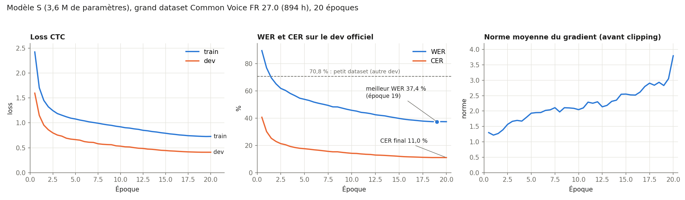

# Recherche — Transformer STT entraîné de zéro

Travail de recherche, séparé du pipeline de production (`jone/`). L'objectif est de concevoir et d'entraîner **notre propre modèle de reconnaissance vocale en français** (un Transformer encodeur + CTC), sans aucun modèle pré-entraîné, puis de le comparer à Whisper, le modèle utilisé par J-ONE. Viendront ensuite l'anglais, puis la synthèse vocale (TTS).

Ce dossier ne modifie rien dans `jone/`. Le robot continue d'utiliser Whisper tant que notre modèle n'atteint pas une qualité comparable.

**Pour aller plus loin :**
- [`JOURNAL_PROJET.md`](JOURNAL_PROJET.md) : chaque étape, ce qui a été observé, décidé, et **pourquoi** ;
- [`NOTIONS_THEORIQUES.md`](NOTIONS_THEORIQUES.md) : 27 notions expliquées, avec un exemple, l'endroit où elles sont appliquées et le code commenté ;
- [`../../docs/etat_avancement_stt.md`](../../docs/etat_avancement_stt.md) : la synthèse en deux pages, pour l'équipe et l'encadrant.

## Où on en est

| Modèle | WER dev | CER dev | Remarque |
|---|---|---|---|
| Référence (taille S, 200 époques) | 72,5 % | 28,0 % | Overfitting fort : la loss dev remonte dès l'époque 31 |
| Essai 1 : + SpecAugment (80 époques) | 70,8 % | 26,1 % | Overfitting supprimé. Le modèle plafonne, il manque de données |
| **Grand dataset (894 h, 20 époques)** | **37,4 %** | **11,0 %** | Même modèle S. Mesuré sur le dev officiel (16 207 clips), différent du dev des lignes au-dessus |

**Test officiel (mesuré une seule fois, 15 936 clips) : WER 43,3 %, CER 14,4 %.** C'est le chiffre à annoncer pour le modèle actuel : le dev a servi à choisir le meilleur modèle, pas le test.

- Le **WER** est le pourcentage de mots faux, et le **CER** le pourcentage de lettres fausses. Ils sont mesurés sur le dev, composé de locuteurs jamais entendus.
- Le modèle **entend** correctement la plupart des sons (CER de 11 % sur le grand dataset), mais **orthographie** encore mal certains mots : il n'a pas de modèle de langue.
- Pour le robot, l'objectif est un **WER inférieur à 20 %**.
- **Entraînement sur le grand dataset et évaluation sur le test faits.** Les phrases de moins de 3 s sont les plus mal reconnues (WER 56,5 %).



## Le pipeline

```
mp3 ──► 16 kHz mono ──► log-Mel (80 bandes, 25 ms / 10 ms) ──► normalisation par bande
          │                                                       │
          │                                     (train seulement) SpecAugment
          ▼                                                       ▼
   texte normalisé                     Conv2D ×2 (÷ 4 en temps) ──► encodage des positions
   (49 caractères + blank)                                         ──► 12 blocs Transformer
          │                                                        ──► 50 scores par instant
          └──────────────────────► loss CTC ◄──────────────────────┘
                                       │
                         décodage glouton ──► texte ──► WER / CER
```

Le modèle de taille « S » a 3,6 M de paramètres : `d_model` 144, 12 blocs, 4 têtes d'attention, `d_ff` 576, dropout 0,1. Chaque bloc a été écrit à la main et vérifié contre l'implémentation de référence de PyTorch.

## Ce qui a été fait, étape par étape

| # | Étape | Résultat principal | Où |
|---|---|---|---|
| 1 | Bases du signal audio | Forme d'onde, FFT, STFT | `00_signal_audio.ipynb` |
| 2 | Choix et téléchargement des données | Common Voice FR, *Scripted Speech 26.0* (fr-FR + fr-CA), plus un corpus spontané pour les tests. Téléchargement via l'API de Mozilla Data Collective | Journal |
| 3 | EDA en 7 points | Train : 12 982 clips, 18,9 h, 275 locuteurs. Vocabulaire réduit de 178 à 49 caractères. 3 fréquences d'échantillonnage. Contrainte du CTC : ÷ 4 possible, ÷ 8 exclu | `stt_01_exploration.ipynb` |
| 4 | Prétraitement | 16 kHz, log-Mel 80 bandes (mêmes réglages que Whisper), normalisation du texte, Dataset et DataLoader avec padding | `stt_02_pretraitement.ipynb`, `stt/` |
| 5 | Le modèle | Sous-échantillonnage, encodage des positions, attention multi-tête, blocs Transformer, tête de sortie et CTC | `stt/model.py` |
| 6 | Test d'overfitting (10 clips, CPU) | Le modèle apprend 10 phrases par cœur (WER de 3,7 %) : le code d'entraînement est correct | `stt_03_overfit_10_clips.ipynb` |
| 7 | Métriques | Décodage CTC glouton, distance d'édition, WER et CER | `stt/metrics.py` |
| 8 | Passage sur GPU (Kaggle T4) | 1,4 min par époque, contre ~40 fois plus sur le PC. Scheduler warmup + cosinus, sauvegardes et reprise après coupure | `stt/training.py` |
| 9 | Entraînement de référence (200 époques) | WER 72,5 %, overfitting net. Le meilleur modèle est choisi sur le WER, pas sur la loss | Journal, `figures/courbes_s_200ep.png` |
| 10 | Essai 1 : SpecAugment (80 époques) | WER 70,8 %, overfitting supprimé, en 2,5 fois moins de temps | `stt/augment.py`, `figures/courbes_s_specaug_80ep.png` |
| 11 | EDA du grand dataset | Train : 621 982 clips, 893,8 h, 10 295 locuteurs. Aucun locuteur commun entre le dev, le test et le train. Vocabulaire conservé. 113 clips à retirer (CTC). Environ 1 h par époque | `stt_05_eda_grand_dataset.ipynb` |
| 12 | Mesure de vitesse | 0,19 s par step, soit 1,02 h par époque. Le CPU n'est pas un goulot. 1,84 Go de mémoire GPU | `stt_06_mesure_vitesse_grand_dataset.ipynb` |
| 13 | Entraînement sur le grand dataset (20 époques) | **WER 37,4 %, CER 11,0 %** (dev officiel), sans overfitting. 3 sessions (Colab, puis Kaggle) avec reprise depuis `last.pt` | `stt_07_entrainement_grand_dataset.ipynb`, `figures/courbes_grand_s_specaug_20ep.png` |
| 14 | Évaluation sur le test officiel | **WER 43,3 %, CER 14,4 %** (15 936 clips), mesurés une seule fois. WER par durée de clip | `stt_08_evaluation_test.ipynb` |
| 15 | Vraie comparaison et vitesse | Ancien dev (mêmes 484 clips) : **70,8 % → 38,3 %**. Ancien test : 44,7 %. **RTF CPU 0,014**, latence médiane 75 ms | `stt_09_comparaison_ancien_dev_test.ipynb` |

## Contenu du dossier

| Fichier | Rôle |
|---|---|
| `stt/text.py` | Normalisation du texte, vocabulaire (49 caractères + blank), encodage et décodage |
| `stt/audio.py` | Lecture des mp3 (soundfile), rééchantillonnage, log-Mel normalisé |
| `stt/augment.py` | SpecAugment : masques de fréquences et de temps |
| `stt/dataset.py` | Lecture des découpages train/dev/test, Dataset PyTorch, mise en batch avec padding |
| `stt/model.py` | Le Transformer complet (pipeline documenté en tête de fichier) |
| `stt/metrics.py` | Décodage CTC glouton, distance d'édition, WER, CER |
| `stt/training.py` | Scheduler (warmup + cosinus) et évaluation sur le dev |
| `00_signal_audio.ipynb` | Expériences pédagogiques sur le signal audio |
| `stt_01_exploration.ipynb` | EDA du petit dataset |
| `stt_02_pretraitement.ipynb` | Prétraitement audio et texte |
| `stt_03_overfit_10_clips.ipynb` | Test d'overfitting sur 10 clips |
| `stt_04_modele_transformer.ipynb` | **Le squelette du modèle** : tout le code de `stt/model.py`, section par section, avec les explications et une vérification par section, jusqu'à une itération d'entraînement complète |
| `stt_05_eda_grand_dataset.ipynb` | EDA du grand dataset, à lancer sur Kaggle (aucune phrase affichée, données dans `/tmp`) |
| `stt_06_mesure_vitesse_grand_dataset.ipynb` | Mesure du temps par step sur le grand dataset (300 steps), avant de fixer la durée de l'entraînement |
| `stt_07_entrainement_grand_dataset.ipynb` | Entraînement de 20 époques sur le grand dataset, en plusieurs sessions Kaggle avec reprise au milieu d'une époque |
| `stt_07_entrainement_grand_dataset_colab.ipynb` | La même chose sur Google Colab (sauvegardes dans Google Drive) |
| `stt_08_evaluation_test.ipynb` | Évaluation unique de `best.pt` sur le test officiel, globale et par durée de clip (aucune phrase affichée) |
| `stt_09_comparaison_ancien_dev_test.ipynb` | `best.pt` sur l'ancien dev et l'ancien test (comparaison avec le petit dataset) et RTF sur CPU, en local (aucune phrase affichée) |
| `figures/` | Courbes des entraînements, pour le rapport |
| `JOURNAL_PROJET.md` | Journal des expériences, des résultats et des décisions |
| `NOTIONS_THEORIQUES.md` | Notions théoriques, avec le code commenté |

## Installation (PC)

Ce dossier a son propre environnement, géré avec [uv](https://docs.astral.sh/uv/) :

```bash
cd recherche/stt_transformer
uv sync
```

## Données

Les données ne sont **pas** versionnées : les conditions de Mozilla Data Collective interdisent de les redistribuer. Pour les obtenir, créer un compte sur [mozilladatacollective.com](https://mozilladatacollective.com), puis télécharger les datasets suivants et les décompresser dans `data/` :

- Common Voice Scripted Speech 26.0 — French of France (segment)
- Common Voice Scripted Speech 26.0 — Canadian French (segment)
- Common Voice Spontaneous Speech 5.0 — French
- Common Voice Scripted Speech 27.0 — French (30,65 Go, 894 h de train), pour l'entraînement sur le grand dataset

La clé d'API se place dans `stt/.env`, qui est ignoré par git. Elle n'apparaît jamais dans le code.

## Entraîner sur Kaggle

L'entraînement se fait sur un GPU T4 de Kaggle (30 h par semaine), dans un notebook **privé**.
1. Dans *Add-ons → Secrets*, ajouter la clé sous le nom `MDC_API_KEY`. Activer *Internet* et choisir *Accelerator → GPU T4*.
2. Écrire 4 cellules :
   - **cellule 1, clone :** `git clone -b stt-transformer-junior` de ce repo, puis `pip install datacollective soundfile` ;
   - **cellule 2, téléchargement :** les données sont téléchargées via l'API dans `/tmp/data`, jamais sauvegardé avec le notebook ;
   - **cellule 3, préparation :** DataLoaders, modèle, optimizer, scheduler, reprise depuis `last.pt` ;
   - **cellule 4, boucle :** forward, loss, backward, clipping, optimizer, scheduler, puis évaluation sur le dev, `best.pt` (le meilleur WER) et `history.json`.

   Le code exact est dans le journal.
3. Lancer **Save & Run All** (exécution en arrière-plan), puis récupérer `history.json` dans *Output*.

## Règles du projet

- **Une seule modification par essai**, comparée à la référence sur le **WER dev**.
- Le **test** n'est mesuré qu'une seule fois, à la fin.
- Aucune phrase réelle du dataset dans les fichiers poussés : le repo est public. Les sorties des notebooks sont effacées avant chaque push.
- Les poids des modèles (`runs/`) et les données (`data/`) restent hors du repo.

## Prochaines étapes

1. Whisper sur le même test officiel (WER et RTF). Fait : ancien dev (70,8 % → 38,3 %) et RTF sur CPU (0,014), voir `stt_09`.
2. Peut-être, un modèle plus gros (la vitesse le permet).
3. Un modèle de langue au décodage, pour corriger l'orthographe.
4. L'évaluation finale : WER sur le test (parole lue et spontanée), RTF, et comparaison avec Whisper (`tools/bench_stt.py`).
5. L'anglais, puis la synthèse vocale (TTS).
